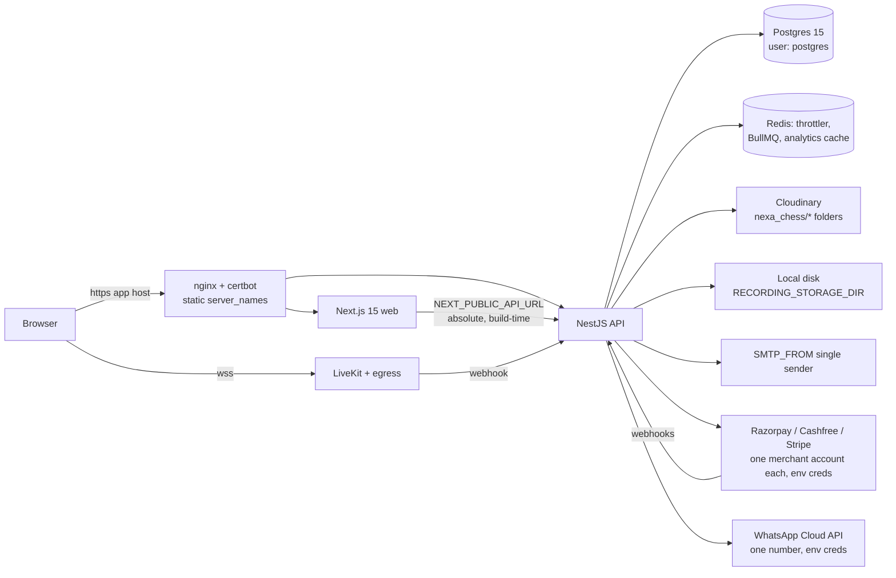
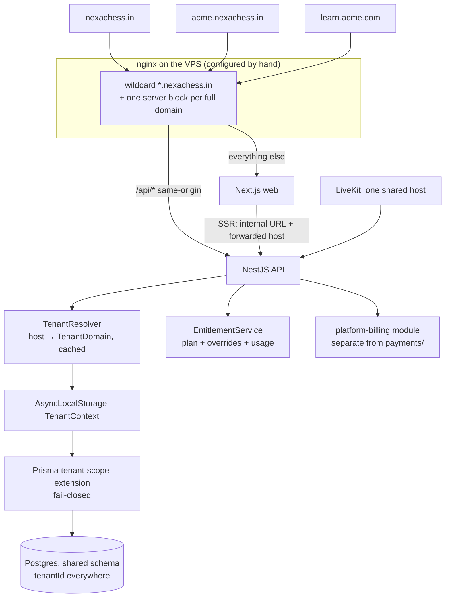

# Multi-tenant white-label SaaS — plan

Status: **approved 2026-11-04; Phase 2 built, Phase 3 in progress** on
`feat/saas-phase2-foundation` (branched off `dev`). The identity decisions (§N-14, §N-15), the database layout
(§N-17) and the start (§N-13) were answered on 2026-11-04. Phase 2 is merged into
`dev` only after the UI redesign has reached `main`, so the two never ship in the
same release.

This is the single plan for the programme. It merges the Phase 0 assessment
(written 2026-10-17) and the owner-decisions design spec (2026-10-19, formerly
`docs/superpowers/specs/2026-10-19-multi-tenant-saas-design.md`). Where the two
disagreed, the owner decisions won; the changes are listed in
[Appendix: what the owner decisions changed](#appendix-what-the-owner-decisions-changed).
Items marked *(builder's call)* were decided by Claude during design, not by the
owner, and can be revisited.

**Built so far (2026-10-19):** the plan/feature/limit half of §G. That covers
`Tenant` (one row, `tenant_nexa`), `PlatformPlan`, `TenantSubscription`,
`TenantSubscriptionEvent`, `PlatformStaff`, `EntitlementService` and the
feature gates. See [SAAS_PLANS.md](SAAS_PLANS.md). This plan replaces two of
those behaviours: `PlatformStaff` as the source of platform powers (§E), and the
fixed "grace = GET/HEAD only" rule (§G).

**Phase 2 progress (2026-11-04, branch `feat/saas-phase2-foundation`):** D1–D3
are built; see [Phase 2 as built](#phase-2-as-built) under §L.

Contents: Summary · 1 Intent and goals · 2 Scope · A current state · B target
architecture · C entity ownership matrix · D schema and migration · E auth and
isolation · F branding, email and WhatsApp · G SaaS billing and entitlements ·
H academies and domains · I platform console · J migrating Nexa · K threat
model and tests · L roadmap · M effort · N decisions · Appendix.

---

## Summary

1. **Today the app is single-tenant by design.** No academy or tenant id exists
   on any data row. `ADMIN` and `SUPER_ADMIN` see every row (`docs/AUTHORIZATION.md`,
   "One academy, platform-wide admins"). Scale of the change: 125 Prisma models,
   ~1,600 Prisma call sites in 125 services, 516 routes in 57 controllers, 80
   raw-SQL calls in 24 files, 19 cron jobs, 9 global "singleton" settings tables
   and ~12 globally-unique business keys.
2. **Target:** many independent Indian chess academies on **one deployment, one
   database, one schema**. Each academy has its own addresses, full white-label
   branding, separate data, and its own payment gateway. The owner runs
   everything from a "Platform" section in Nexa's admin area. Nexa becomes the
   first academy (`tenant_nexa`) and its users notice no change.
3. **Three features are already white-label at the single-tenant level.** Invoice
   seller details (`InvoiceSettings`), board appearance and typography each have
   an admin-editable singleton and a 3-layer resolver. Turning each singleton
   into a per-tenant row is most of the branding work for those areas.
4. **Name clash.** `Plan`, `Subscription`, `Entitlement`, `Order` and `Invoice`
   already mean *the academy bills its students*. SaaS billing (*the academy pays
   the owner*) uses separate tables and names (`PlatformPlan`,
   `TenantSubscription`, …) and a separate module. It is never a second mode of
   `PaymentService`.
5. **Data migration starts in Phase 2, not at the end.** Production is one live
   tenant, deployed continuously from `main`, and migrations are never reversed.
   So `tenantId` columns arrive already backfilled to `tenant_nexa`, in additive
   expand/contract steps.
6. **The browser must call the API on its own address.** The web calls an
   absolute, build-time `NEXT_PUBLIC_API_URL` with cookies shared across
   `api.`/`www.`. A full domain like `learn.acme.com` calling `api.nexachess.in`
   is cross-site, so cookies wouldn't be sent. **Every academy host serves the
   API same-origin under `/api`.**
7. **The database connection bypasses row security.** The app connects as the
   `postgres` superuser, so Postgres RLS would be silently skipped. RLS needs a
   dedicated non-superuser role first; it is follow-up hardening, not part of the
   first isolation release.
8. **Enforcement shape:** `tenantId` on every academy-owned table, child rows
   included, plus (1) a fail-closed Prisma extension driven by a request-scoped
   tenant context, modelled on `soft-delete.extension.ts`; (2) composite foreign
   keys on core relations; (3) RLS later. A two-academy version of the existing
   cross-user integration suite is the gate.

---

## 1. Intent and goals

Nexa Chess today is one academy's platform. The owner wants **many independent
chess academies** to run on it, where:

- each academy looks like its own product: its own address and brand, with no
  sign of Nexa;
- each academy's data is completely separate from every other academy's;
- the owner creates academies and controls, without a developer, what each one
  pays and gets: plans, prices, features, limits and the content it can use;
- each academy collects its students' fees into its **own** payment account and
  pays the owner for its plan.

No second academy is signed yet, so everything commercial (plans, prices,
features, limits, content, one-off deals) is configurable at runtime.

Goals:

1. **Shared tenancy.** One deployment, database and schema. Every academy-owned
   row carries its academy; every request runs in exactly one academy; nothing
   crosses.
2. **Platform console** for academies, plans, features, limits, content packs,
   custom deals, domains, subscriptions and support access (§I).
3. **Addresses.** Every academy gets `<slug>.nexachess.in` automatically and may
   have any number of full domains (`learn.acme.com`).
4. **Full white-label.** On an academy's addresses, people see only that
   academy's name, logo, colours and wording.
5. **Two money flows.** Academies pay the owner; students pay their academy's own
   gateway account.
6. **Nexa unchanged.** `nexachess.in` keeps Nexa's brand, data, payments and logins.

## 2. Scope

### Not in this programme

- Separate deployments or databases per academy (rejected by the owner).
- Self-serve academy sign-up. Only the owner creates academies.
- One login shared across academies, or an academy switcher.
- Automatic TLS / certificate issuance for full domains. The owner configures
  DNS, certificates and the proxy on the VPS by hand.
- Customer-supplied CSS or JavaScript.
- Sending email from an academy's own email domain (later).
- Deleting a whole academy. Suspend and reactivate are in scope. *(builder's call)*
- Scaling beyond the single VPS. Capacity is a known risk (§N-2), not solved here.

### Failure even if it "works"

- **Any** academy can see, change or infer another academy's data: through a
  route, list, search, cache, job, file URL, live-class token, export or email.
- A Nexa student or coach is logged out, loses data or sees anything different.
- "Nexa", Nexa's logo or Nexa's colours appear in another academy's pages, email
  content, PDFs or authenticator entry. **Accepted exceptions (owner decision):**
  `nexachess.in` in academy subdomains and in the shared email sender address;
  the owner's company name on the plan checkout and on plan invoices to academies.
- Nexa's private puzzles, courses or student data become visible to another
  academy without the owner publishing them.
- A student's payment lands in the wrong account, or an academy's plan payment
  lands anywhere but the owner's account.
- A plan change silently deletes an academy's data.

### Constraints

- **India only for now (owner decision):** every academy is Indian, prices and
  payments are INR, and tax is the existing GST engine made per-academy. Don't
  generalise the tax engine.
- Every rule in `CLAUDE.md` holds: no auth guards; `authenticateUser`;
  `API_ROUTES`; integer minor units; `applyProviderState` as the single funnel;
  UTC storage; soft delete via `TrashRepository`.
- Every schema step is additive (expand/contract, §D), because rollback restores
  images and never reverses migrations.
- Students are minors: platform analytics are aggregate-only; Sentry stays
  `user.id` + role (+ a tenant tag).
- One ARM64 VPS runs everything.
- The owner approves each phase before the next starts. Nothing is merged into
  `dev`/`main` without explicit approval.

---

## A. Current architecture assessment

| Area | What exists | Single-academy assumption |
|---|---|---|
| Stack | Turborepo; Next 15 App Router; NestJS 11; Prisma 6 / Postgres 15; Redis 7; LiveKit; one ARM64 VPS | One deployment = one academy |
| Identity | `User` with global `@unique email` / `username`; `role` enum on the user (`SUPER_ADMIN`, `ADMIN`, `COACH`, `STUDENT`); MFA, lockout, rotating refresh sessions | Accounts and roles are global |
| Authz | No guards. Controllers pass the token string → `authenticateUser` → per-service `assertCanX` / `getXVisibilityWhere`. Admins get `{}` (everything) | `{}` would mean "every tenant" |
| Web gating | `middleware.ts` + `routeAccess.ts` read the role from the JWT payload | Fine as a routing hint. Needs no tenant knowledge |
| Soft delete | `$extends` query extension + `TrashRepository` | A precedent for a tenant-scope extension |
| Global settings (singletons) | `AttendancePolicy`, `LiveClassPolicy`, `ChessAppearanceSettings`, `TypographySettings`, `PuzzleScoringSettings` (id `"default"`), `InvoiceSettings` (id `"default"`), `PaymentSetting`, `MessagingRule` (unique per `event`), `OfflinePaymentMethod` (unique `key`) | One row for everyone |
| Number sequences | `InvoiceSequence`, `CreditNoteSequence`, `PayslipSequence` keyed by year only | One gap-free series. Legally each seller (GSTIN) needs its own |
| Student billing | `Plan → Order → Payment → Entitlement`, `Subscription`, `Invoice`, `CreditNote`, `Discount`; provider creds and seller name from env (`RAZORPAY_*`, `PAYMENTS_SELLER_*`) | Nexa is the only merchant |
| Payroll | `CoachCompensation*`, `PayrollPeriod` unique on `(periodType, startDate, endDate)`, `Payslip` | One payroll calendar |
| Live class | `LiveSession.roomName = class_<classId>`; tokens only from the API; webhook `POST /webhooks/livekit` maps room → class | Room ids are cuids, so unique globally. The tenant would come from the class |
| Files | Cloudinary: avatars (public), PGNs (`nexa_chess/pgns`), invoices/payslips (`type: authenticated`); recordings on local disk with one `RECORDING_STORAGE_LIMIT_GB` | No tenant in paths or quotas |
| Jobs | 19 `@Cron` jobs under `JobLockService.runExclusive`. BullMQ is optional | Sweeps cover all rows; per-row config read from singletons |
| Caches | Analytics `cache.wrap` key = range + filters, **with no user and no tenant**. Stockfish cache keyed by FEN | With two tenants the analytics cache **leaks data across tenants** |
| Raw SQL | 80 calls in 24 files, mainly analytics sections, activity history, puzzle catalogue/training, puzzle rush, job locks | Each one needs a hand-written tenant predicate |
| Branding (web) | `SITE_NAME = "Nexa Chess"` (`lib/site.ts`); `/academy` marketing site with hard-coded Nexa content; ~62 source files mention the brand; CSS-variable `--rgb-*` theme tokens | One brand at build time |
| Email | One `SMTP_FROM`; brand strings in `mail.service.ts`, `messaging.format.ts`, MFA issuer | One sender |
| Ops | `deploy-production.sh`, image rollback, `pg_dump` backups of the whole database (also "Backup now" in the admin UI) | A backup is a whole-platform object |
| Tests | Jest unit tests; integration suite with `auth-boundary`, `cross-user-access` (two mirror-image "worlds"), `admin-routes`, `route-auth.spec.ts`; Playwright e2e | The two-world harness is the natural base for two-tenant tests |

---

## B. Target architecture

### Hosts

- `<slug>.nexachess.in`: every academy gets one on creation. Reserved slugs
  (`www`, `api`, `console`, `livekit`, `admin`, `mail`, …) are refused.
- Full domains (`learn.acme.com`): any number per academy, added by the owner (§H).
- `nexachess.in` and Nexa's current hostnames: Nexa's academy, as today. The
  Platform section lives here too; there is **no separate console host** (owner
  decision).
- `api.nexachess.in` stays reachable for webhooks and anything else that uses it.
- LiveKit stays on one shared host. A WebRTC token carries no cookie, so it
  doesn't need to be same-origin.

### Request lifecycle

1. nginx forwards `Host`. The API trusts `X-Forwarded-Host` only through the
   existing `TRUST_PROXY_HOPS`.
2. `TenantResolver` normalises the host (lowercase, strip port and trailing dot,
   punycode) and looks it up in `TenantDomain` (status `ACTIVE`). Lookups are
   cached in-process and in Redis for 60 s; a change invalidates the cache. An
   unknown host gets a "no such academy" page and **never falls back to Nexa**.
3. That sets a **public context** `{ tenantId, source: "host" }`: enough for login,
   public demo pages, lead forms and branding.
4. `authenticateUser` also requires `user.tenantId === context.tenantId` and
   `session.tenantId === context.tenantId`, then upgrades the context to
   `{ tenantId, userId, role }`.
5. The address only names the academy. Permission still comes from the user's
   role and the existing per-service checks.

### Tenant and subscription state are separate

- `Tenant.status`: `PROVISIONING | ACTIVE | SUSPENDED | DEACTIVATED` (a
  `PENDING_DELETION` state arrives with academy deletion, later).
- `TenantSubscription.status`: `TRIALING | ACTIVE | PAST_DUE | GRACE |
  CANCEL_SCHEDULED | EXPIRED | CANCELLED`.
- One policy function, `resolveTenantAccessMode(tenant, subscription, lapsePolicy)`
  in `@nexa-chess/types` (it exists today without the lapse policy), returns
  `FULL | GRACE | LOCKED`, and in grace, which switches stay on (§G).

---

## C. Entity ownership matrix (all 125 models)

Legend:
- **P**: platform-wide, no `tenantId`.
- **T**: academy-owned, gets a `tenantId NOT NULL` column.
- **T\***: an academy-owned singleton that becomes one row per academy.
- **F**: academy-owned financial or immutable record (`onDelete: Restrict`, never edited).

**Accounts belong to one academy** (owner decision 2026-11-04, §N-14).
The same email may exist in two academies as two unrelated accounts with
separate passwords, MFA and sessions. Email and username become unique **per
academy**. There is no membership table: `User` gets a `tenantId` and keeps its
`role`.

| Domain | Models | Class | Notes |
|---|---|---|---|
| Identity | `User` | T | `email` / `username` unique → `(tenantId, email)` / `(tenantId, username)`, checked with `prisma.withDeleted` as today |
| | `UserMfa`, `UserChessAppearancePreference`, `UserTypographyPreference`, `ExternalChessAccount` | T | Follow their user's academy |
| | `AuthSession`, `PasswordResetToken`, `EmailVerificationToken` | T | Bound to the academy they were issued on. Reset links are built from the academy's primary domain, **never from the `Host` header** |
| | `StudentProfile`, `CoachProfile` | T | `userId @unique` still holds (one account = one academy) |
| | `AccountDeletionRequest` | T | Handled by the academy admin |
| Org structure | `Batch`, `BatchCoach`, `BatchStudent`, `TrashAuditLog` | T | Composite FK `(tenantId, batchId)` |
| Scheduling | `CoachClass`, `BatchClassSchedule`, `BatchClassScheduleRule`, `BatchScheduleException`, `ClassChangeRequest` (read-only history), approval requests | T | |
| Demo / marketing | `DemoSchedule` (`slug @unique` → `(tenantId, slug)`), `DemoClassRegistration`, `VisitorSession`, `Lead`, `LeadActivity`, `LeadNote` | T | Public forms resolve the academy from the host |
| Attendance | `ClassAttendance`, `AttendanceLog`, `CoachAttendance`, `CoachAttendanceLog` | T | |
| | `AttendancePolicy` | T\* | |
| Live class | `LiveSession`, `LiveClassPull`, `LiveClassWaitingParticipant`, `LiveClassScreenShareRequest`, `LiveChatMessage`, `LiveClassPuzzleAssignment`, `LiveClassLeaderboardAdjustment`, `LiveClassSimul`, `LiveClassSimulGame`, `LiveClassMatchRound`, `LiveClassMatchGame`, `LiveClassMatchChallenge`, `LiveClassMovePoll`, `LiveClassMovePollAnswer`, `LiveClassPuzzleRush`, `LiveClassPuzzleRushEntry`, `LiveClassToolState`, `LiveClassChapter`, `LiveClassActivityQueue`, `LiveClassActivityQueueItem` | T | `scopeKey` uniques (`LiveClassToolState`, `LiveClassChapter`) become tenant-prefixed |
| | `LiveClassPolicy` | T\* | |
| | `LiveClassPreset` | T | Scope `ORG` means "this academy". A platform preset is a `SYSTEM` scope with no `tenantId` (or stays in code) |
| Appearance | `ChessAppearanceSettings`, `TypographySettings` | T\* | The admin layer of the 3-layer resolver becomes "academy admin" |
| Courses | `Course`, `CourseModule`, `StudentCourseProgress`, `StudentModuleProgress`, `Practice`, `StudentPractice` | T | Published courses can join a content pack (§I) |
| Assignments | `Assignment`, `AssignmentBatch`, `StudentAssignment`, `StudentAssignmentAttempt`, `AssignmentPuzzle` | T | |
| Puzzles | `PuzzleTopic`, `Puzzle`, `PuzzleAttempt`, `PuzzleRatingChange`, `StudentProgress`, puzzle activities | T | `Puzzle` visibility `GLOBAL` means academy-wide. `(source, sourceId)` unique → `(tenantId, source, sourceId)`. Sharing with other academies is only through content packs |
| | `PuzzleScoringSettings` | T\* | id `"default"` → keyed by `tenantId` |
| | `LichessPuzzle`, `LichessCatalogueRelease` | P | Shared read-only catalogue; a built-in content pack |
| Revision | `RevisionItem`, `RevisionReview` | T | |
| Games | `ChessGame`, `GameAnalysis`, `GameAnalysisSide` | T | `sourceKey @unique` and `(ownerId, contentHash)` get `tenantId` added. `GAME_ANALYSIS_DAILY_LIMIT` becomes a per-academy quota |
| Communication | `Notification`, `Announcement`, `Conversation`, `ConversationMember`, `ChatMessage`, `MessageDelivery` | T | `Conversation.batchId/directKey @unique` become tenant-scoped. `MessageDelivery.(channel, dedupeKey)` gets `tenantId` added |
| | `MessagingRule` | T\* | `event @unique` → `(tenantId, event)` |
| Feedback | `FeedbackForm`, `FeedbackResponse`, `FeedbackAnswer` | T | |
| Knowledge base | articles and versions | T | Each academy's help centre is its own |
| Analytics | `StudentActivity`, `AnalyticsEvent`, `RecordingWatchProgress` | T | |
| | `StorageSnapshot` | T + P | Splits into a per-academy usage snapshot plus a platform total. `capturedDate @unique` → `(tenantId, capturedDate)` |
| Student billing | `Plan` (`code @unique`), `Order` (`orderNumber`, `idempotencyKey`), `Payment`, `PaymentAttempt`, `PaymentWebhookEvent`, `Refund`, `Subscription`, `Entitlement`, `Invoice` (`number`), `InvoiceAuditLog`, `CreditNote` (`number`), `BillingProfile`, `Discount` (`code`), `DiscountRedemption`, `ManualPaymentRecord` | F | Each business key becomes `(tenantId, key)`. Provider ids (`provider, providerPaymentId`) get `tenantId` added, since each academy has its own merchant account |
| | `InvoiceSettings`, `PaymentSetting`, `OfflinePaymentMethod` | T\* | Seller identity moves out of `PAYMENTS_SELLER_*` env into the academy row |
| | `InvoiceSequence`, `CreditNoteSequence` | F | Primary key `year` → `(tenantId, year)`: a gap-free series per seller |
| | `PaymentProviderEvent` | T | Provider-health samples per academy merchant account; the platform aggregates them |
| Payroll | `CoachCompensationProfile`, `CoachCompensationRate`, `PayrollRule`, `PayrollPeriod` (unique → `+tenantId`), `CoachPayrollRecord`, `PayrollAdjustment`, `CoachPayout`, `Payslip` (`documentNumber`) | F | |
| | `PayslipSequence` | F | `(tenantId, year)` |
| Infrastructure | `JobLock`, `ProcessedWebhookEvent` | P | LiveKit event ids are globally unique |

The model list is from 2026-10-17. Models added since (approvals, puzzle
activities, knowledge base, and so on) are classified in Phase 3 by the schema
test (§K), which fails any model that isn't on the platform list and has no
`tenantId`.

**New features are academy-owned by default.** Anything built after this plan
(for example a tournaments module, which doesn't exist today) gets `tenantId`
on every table. Making a model platform-wide means adding it to `PLATFORM_MODELS`
with a one-line reason, reviewed like the raw-SQL list.

**Child rows get their own `tenantId`, not just the root.** Three reasons:

1. The Prisma extension can filter any model without a join.
2. RLS policies stay one line each.
3. Composite FKs `(tenantId, parentId) → parent(tenantId, id)` on core relations
   make a cross-academy link impossible in the database, even if application
   code is wrong.

### New models

All are platform-wide (P) unless noted. Names are proposals. Each needs its
getter in `prisma.service.ts` (CLAUDE.md §7 rule 1).

- `Tenant` (exists): add slug (unique, reserved-word list), primaryDomainId,
  timezone, country.
- `TenantDomain`: hostname (unique, normalised), tenantId, kind `SUBDOMAIN | CUSTOM`,
  status `PENDING | ACTIVE | REMOVED`, lastCheckedAt, lastCheckResult.
- `TenantBranding` (T\*): validated JSON settings, draft and published versions,
  asset references.
- `PlatformPlan` (exists) + `PlatformPlanVersion`: a subscription keeps the price,
  features, limits and packs of the version it signed up on.
- `TenantSubscription`, `TenantSubscriptionEvent` (exist): the append-only event
  log records each transition's source (webhook, reconcile, console, system).
- `TenantLapsePolicy`: per plan, with a per-academy override (§G).
- `PlatformOrder`, `PlatformPayment`, `PlatformInvoice`, `PlatformInvoiceSequence`,
  `PlatformWebhookEvent`: never shared with the student-billing tables.
- `TenantUsage`: counters per metric.
- `TenantPaymentCredential` (T) and `TenantWhatsAppCredential` (T): AES-256-GCM
  encrypted, the same approach as `UserMfa`.
- `ContentPack`, `ContentPackItem`, `PlanContentPack`, `TenantContentPackOverride` (§I).
- `PlatformAuditLog`.
- `SupportSession`: staff user, academy, reason, started/expires/ended, plus each
  request logged against it.
- `PlatformStaff` (exists) is **retired** as the source of platform powers (§E).

---

## D. Schema change and migration approach

Every step is additive, so images built before the step keep working after it.
That's required because rollback restores images and never reverses migrations.

| Step | Migration | App code at that point |
|---|---|---|
| D1 | Create `tenant_domains`; add the new `tenants` columns. Insert Nexa's current production hostnames as `ACTIVE` domains of `tenant_nexa` (the tenant row already exists) | Unchanged |
| D2 | Add `"tenantId" TEXT DEFAULT 'tenant_nexa'` (nullable) to every T/T\*/F table, `users` included. No backfill: on Postgres 11+ a constant default is metadata-only, so existing rows read `'tenant_nexa'` without a table rewrite | Old code still inserts without `tenantId`, and the default covers it |
| D3 | Deploy code that always sets `tenantId` from context, with the extension in **audit mode**: it logs, doesn't throw, when context is missing | Watch logs until there are no missing-context hits |
| D4 | Set `NOT NULL`, add `(tenantId, …)` indexes mirroring the hot indexes, add composite uniques **next to** the old global ones (`users.email`, `plans.code`, `invoices.number`, `messaging_rules.event`, …), add composite FKs on core relations | Extension switches to **enforce** mode |
| D5 | Drop the old global uniques and the `'tenant_nexa'` default; number sequences' primary key `year` → `(tenantId, year)` | A second real academy is allowed only after this |

A partial unique index `WHERE "isDeleted" = false` (soft-deletable models) gains
`tenantId` as its leading column. The trash checklist in `README.md` gains a
tenant step.

---

## E. Authentication, authorization and isolation

### Identity and roles

- `User.tenantId` is the account's academy. `AuthenticatedUser` gains `tenantId`;
  `role` keeps its meaning inside that academy. The ~125 services' existing
  `user.role` checks keep working unchanged, which is the main reason the
  migration is tractable.
- Login on an academy host looks up `(context.tenantId, email)`. An account in
  another academy is simply "not found", with the same generic error as a wrong
  password. Lockout, MFA and throttles are unchanged and per account.
- **Platform powers = `role === SUPER_ADMIN` and `tenantId === 'tenant_nexa'`**
  (owner decision). A super admin of any other academy has no platform powers,
  ever. This replaces the `PlatformStaff` row; `admin-routes.int-spec.ts` changes
  from "every tenant role is 403 on `/platform`" to "every role except Nexa's
  `SUPER_ADMIN` is 403". MFA is always required for platform actions.
- Platform screens act across academies only through the data layer's one
  explicit bypass (`asPlatform`, below), never by dropping the academy filter ad hoc.
- Existing role rules carry over per academy: nobody edits their own role, and
  the last `SUPER_ADMIN` of an academy can't be removed.

### Sessions and cookies

- A session issued on academy A's host is rejected on any other host
  (`auth_sessions.tenantId` must equal the resolved tenant).
- Cookies become **host-only**. Because the platform domain stays
  `nexachess.in` (owner decision), Nexa's existing `.nexachess.in` domain-wide
  cookies would reach every academy subdomain. The plan therefore includes an
  explicit migration to host-only cookies **with no forced logout for Nexa**
  *(builder's call on how)*. Proposed: on the next refresh, the API reissues
  the cookies host-only and clears the domain-wide ones. Until that completes, the session
  binding keeps a Nexa token useless on another academy's host.
- The request-origin (CSRF) check accepts the resolved academy's own active
  domains instead of the static `CORS_ORIGIN` list.

### Tenant scoping in the data layer

1. **TenantContext**: an AsyncLocalStorage store set by the resolver middleware,
   upgraded in `authenticateUser`, and entered explicitly by jobs via
   `runInTenant(tenantId, fn)`.
2. **Prisma `tenantScope` extension** for models in `TENANT_MODELS`:
   - It adds `tenantId` to `where` on reads, updates, deletes and counts, and to
     `data` on create/upsert/createMany. `findUnique` is handled the way
     `soft-delete.extension.ts` already handles it.
   - With no context, it **throws** (fail closed).
   - `prisma.asPlatform(reason)` is the only bypass. It's grep-able and limited
     to an allow-list of call sites (Platform section, global sweeps).
   - Known Prisma limit: nested writes don't run the extension for the child
     model. The `NOT NULL` column (and, after D5, the raising default) catches a
     missing `tenantId`, and the extension requires an explicit `tenantId` in
     nested `create` payloads. Composite FKs were **not** built (see "Tenant
     integrity monitoring" below); a row linked to another academy's row is
     found by the nightly check instead.
3. **Raw SQL** (80 calls in 24 files): each gets an explicit
   `"tenantId" = ${tenantId}`. A unit test fails any new `$queryRaw` file that
   isn't on a reviewed list, the same way `route-auth.spec.ts` works.
4. **Visibility helpers** (`getXVisibilityWhere`) stay as they are. Admin `{}` is
   safe because the extension adds the academy filter.
5. **RLS (follow-up hardening, not required for Phase 3)** *(builder's call)*:
   a `nexa_app` role (`NOSUPERUSER NOBYPASSRLS`) for the API, `postgres` for
   migrations only, and policies `tenant_id = current_setting('app.tenant_id', true)`
   set per transaction by the extension. Measure the per-query overhead first; if
   it's too high, apply RLS only to F and identity tables.

### Tenant integrity monitoring (monitoring, not enforcement)

Built 2026-11-05 instead of slice 3b's composite foreign keys. **It detects; it
never blocks.** Application-level isolation (TenantContext, the `tenantScope`
extension, `authenticateUser`, the reviewed raw-SQL list, the two-academy
suites) stays the guard. No foreign key is changed and no trigger is added.

- **Why not composite FKs:** 314 single-column relationships link academy
  tables; 127 of them are `onDelete: SetNull`, and a composite FK
  `(tenantId, parentId)` would null `tenantId` too (a `NOT NULL` column), so
  those deletes would fail. The rest would need relation rewrites across the
  code and write-blocking constraint validation in a production migration.
- **What it checks** (`apps/api/src/tenancy/integrity/`): every single-column
  foreign key between two tables that both carry `tenantId`, read from
  `pg_constraint` at run time, so a new relation is covered with no code
  change. A row whose `tenantId` differs from its parent's is a violation.
  Read-only, one relationship per transaction with a 60 s statement timeout; a
  relationship that errors is reported and the rest still run.
- **Legitimate cross-academy links** (`PLATFORM_OPERATOR_LINKS`): a platform
  operator (Nexa `SUPER_ADMIN`, `isPlatformOperator`) acting on an academy:
  `tenant_subscription_events.actorUserId`, `platform_payments.recordedById`,
  `platform_support_sessions.staffUserId`. Exempt **only** when the parent user
  is an operator; anyone else there is still a violation. Adding an entry is a
  security review, like the raw-SQL list.
- **When:** nightly at 03:40 UTC (`TENANT_INTEGRITY_CRON`) under
  `JobLockService.runExclusive(JOB_LOCKS.tenantIntegrity)`, and on demand from
  the platform console (Integrity tab, "Run now").
- **Results:** each run is a `tenant_integrity_runs` row (platform table:
  status `OK` / `VIOLATIONS` / `FAILED`, relationship and row counts, up to
  `TENANT_INTEGRITY_SAMPLE_LIMIT` (20) example rows per relationship with the
  child's primary key, both academy ids and the parent id; no row content).
  Kept 180 days (`RETENTION_RULES`).
- **Reporting:** `GET /platform/integrity/runs` and `POST` (run now), platform
  operators only (others 403). A run with findings or errors emails every
  active Nexa `SUPER_ADMIN` through the system message `TENANT_INTEGRITY_ALERT`
  (group `PLATFORM`, `platformOnly`: other academies' admins never see or edit
  it), with a link to `/admin/platform?tab=integrity`.
- **Tests:** `tenant-integrity.rules.spec.ts` (SQL shape, operator exemption
  only on listed links, every exempt link is a real relation to `User`, email
  summary), `tenant-integrity.int-spec.ts` (three academies: correct data and
  operator actions find nothing; a non-operator actor and raw-SQL corruptions
  towards Nexa and towards another academy are reported with table, row ids and
  both academies; console access; the nightly run; the alert message stays
  Nexa's).
- **Staging, 2026-11-05:** first run on `vps_dev_saas` (D5 applied, two
  academies): 314 relationships in about 2 s, status `OK`, nothing found; the
  operator's subscription event on the test academy is the one cross-academy
  link and is correctly exempt.
- **Database-level enforcement stays on the roadmap as RLS** (item 5 above and
  "Later" in §L), not part of this.

### Asynchronous and realtime paths

- **Crons**: global sweeps read rows under `asPlatform`, then process each row
  inside `runInTenant(row.tenantId)`, so per-academy config (messaging rules,
  attendance policy, invoice settings) resolves for the right academy.
- **BullMQ**: every payload carries `tenantId`, and the worker checks it against
  the row it loads. A mismatch is dropped and reported. The `jobId` stays
  row-derived.
- **Caches**: the analytics cache key gains `tenantId` (must-fix in Phase 3). The
  Stockfish FEN cache stays global because it holds no personal data. Every new
  `cache.wrap` key needs a tenant component, enforced by a helper or lint rule.
- **LiveKit**:
  - Room names become `t_<tenantId>_class_<classId>`.
  - Token issuance already checks class access; it now also checks
    `class.tenantId === context.tenantId`.
  - The webhook derives the academy from the `LiveSession` row, never the packet.
    A per-academy concurrent-room limit is checked at room start (it exists today
    as `maxConcurrentLiveClasses`).
- **Throttling**: the existing keys plus a per-academy bucket, so one academy
  can't use up shared capacity (Stockfish, egress).
- **Files**:
  - Cloudinary paths become `tenants/<tenantId>/…`. The `nexa_chess/…` paths stay
    valid for Nexa's existing assets.
  - Recordings go under `<RECORDING_STORAGE_DIR>/<tenantId>/`, with a quota per academy.
  - Download-time checks (signed stream tokens, Cloudinary `authenticated`
    downloads) gain the academy comparison.
  - PGN uploads move from public to `authenticated`.

---

## F. Branding, email and WhatsApp

### What an academy can set

Name, logo (light/dark), favicon, brand colours, default theme, login-page
image, contact details, SEO title/description, link-preview image, landing-page
content, legal-page details, email sender name and reply-to, the invoice /
payslip seller block (per-academy `InvoiceSettings`), and board appearance and
font defaults (existing resolvers, now per academy).

The owner sets these when creating the academy. Afterwards the academy's admins
can edit them **if** the plan's `customBranding` feature is on.

### How it renders

- The root layout's `generateMetadata` and the `<html>` element read a cached
  `GET /api/tenant/public-config`, resolved by host.
- Brand colours are injected server-side as `--rgb-*` triplets. They must stay
  triplets, or Tailwind `/opacity` utilities produce no CSS.
- No customer CSS or JS is ever executed. Colours are validated as hex,
  converted server-side and **checked against WCAG AA contrast** on `app-surface`
  and `app-background`; a failing colour is rejected with an explanation.
- Draft / publish / reset uses a preview route that renders the draft for that
  academy's admins only.
- **Assets:** PNG/JPEG/WebP, plus SVG if §N-9 allows it (sanitised or
  rasterised). Size and dimension limits via `RequireAccessTokenInterceptor` +
  multer `limits`, stored under `tenants/<id>/branding/`. Logos are public by nature.

### Nexa disappears everywhere on other academies

Tab titles, header, login, favicon, preview images, landing page, FAQ, SEO data
and `llms.txt`, emails, PDFs (invoices, payslips, credit notes), legal pages,
WhatsApp text, and the authenticator-app entry (issuer = **the academy's name
only**).

- ~62 files mention the brand today. `SITE_NAME` and the API strings (mail, MFA
  issuer, messaging format, PDFs) read the academy name.
- `nexachess.in` keeps Nexa's `/academy` marketing site. Other academies get a
  generic, block-based landing page (hero, programmes, contact, demo booking)
  built from the existing section components and their branding content.
- `features/legal/content.ts` becomes per-academy (§N-12).
- A Playwright smoke test on a second academy's address finds no "Nexa" text.

### Email

Sent from one shared platform address with the **academy's name** as the sender
name and the academy's contact as `Reply-To` (owner agreed). That keeps SPF/DKIM
under platform control. Sending from an academy's own domain needs a provider
with per-domain DKIM; it's later.

### WhatsApp

An academy connects its **own** WhatsApp Business credentials, as it does its
payment gateway. Without them, WhatsApp is off for that academy and email still
works. Nexa keeps today's number. *(builder's call: the shared Nexa number would
show Nexa's business name.)*

---

## G. SaaS billing and entitlements

### Module boundary

`apps/api/src/platform-billing/`, with its own tables and webhook routes
(`/platform-billing/webhooks/<provider>`, added to the origin-check exempt list).
It may reuse provider adapters from `payments/providers/` through a narrow
interface. That needs a written exception to the "no adapter outside
`payments/providers/`" rule, or the adapters move to a shared package. It never
touches `PaymentService.applyProviderState`, student `Entitlement`s or student
invoices. Money stays in integer minor units via `toMinorUnits`.

### Plans: fully customisable from the console

- Create, edit, duplicate and retire plans. Retired = no new subscriptions;
  existing ones continue.
- Per plan: name, description, display order, public/hidden; price per billing
  period (monthly and yearly, INR only for now); trial length; lapse policy;
  feature switches (every key in the feature catalogue); every limit (number or
  unlimited); content packs (§I).
- **Editing a plan applies to new subscriptions only.** Each subscription keeps
  the version it signed up on. The console offers an explicit "apply to existing
  subscribers" action, logged per academy. *(builder's call; replaces today's
  "editing a plan re-scopes everyone".)*
- **Feature catalogue stays in code**, because every feature must be enforced by
  an API route (the `SAAS_PLANS.md` rule). The console switches any catalogued
  feature on or off per plan and per academy; a brand-new feature or limit type
  still needs a developer.
- **Custom deals per academy:** add/remove features, override any limit,
  add/remove content packs, a custom price, and a note. Shown clearly as overrides.
- Starter/Growth/Business/Enterprise are seed data, not code.

### Lapse policy: per plan, overridable per academy (owner decision)

- *Past-due days*: days after a missed payment with full access (owner banner + email).
- *Grace days*: days after that in grace; then locked.
- *What still works in grace*: switches for at least live classes and joining them
  (with attendance), homework and puzzle attempts, students paying fees, and chat.
  Admin growth (new students, coaches, batches) is always blocked in grace.
  *(builder's call on the exact switch list)*
- Locked: members can't use the academy; its super admin can sign in to pay or
  export. Nothing is ever deleted.

This replaces today's fixed "grace = GET/HEAD only" rule in `resolveTenantAccessMode`.

### State machine

Allowed transitions: `TRIALING → ACTIVE | EXPIRED`;
`ACTIVE → PAST_DUE | CANCEL_SCHEDULED`; `PAST_DUE → ACTIVE | GRACE`;
`GRACE → ACTIVE | EXPIRED`; `CANCEL_SCHEDULED → ACTIVE | EXPIRED`;
`EXPIRED → ACTIVE` (resubscribe).

Every transition goes through one function, `applySubscriptionTransition`. It
has an allowed-transition guard, an idempotent `PlatformWebhookEvent (provider, eventId)`,
and appends a `TenantSubscriptionEvent`. A browser "success" callback only
triggers a provider read (reconcile); it never grants anything, the same rule as
student payments.

### Enforcement

`EntitlementService` (exists) offers `assertFeature`, `assertWritable` and the
limit checks. Limits are checked inside the creating transaction under a
transaction-scoped advisory lock (as built today), so concurrent requests can't
pass a hard limit. Usage counters in `TenantUsage` are reconciled nightly from
real counts.

- A **downgrade never deletes anything**. Over-limit resources stay readable;
  only creates are blocked.
- **Gate placement:** create student/coach (`UserService`), class start
  (`LiveClassService`), recording start, analysis enqueue, WhatsApp dispatch,
  domain add, and module entry for payroll, analytics and payments.
- `EntitlementService.currentTenantId()` switches from `tenant_nexa` to the
  request's academy in Phase 2.

### Two money flows

1. **Academy → owner (platform billing):**
   - Razorpay, Cashfree or Stripe on the **owner's** merchant account (§N-11), or
     a manual payment the owner records in the console.
   - Each billing period the academy's super admin pays from the academy's
     subscription page; the owner can also send a payment link. No card-on-file
     auto-debit in v1. *(builder's call)*
   - The owner issues each academy a GST invoice under the owner's company
     details, through the shared tax engine, with its own number series.
   - Missed payment: past due → grace → locked, timed and scoped by the lapse policy.
2. **Student → academy (existing `payments/`):**
   - Each academy's admins connect their **own** Razorpay / Cashfree / Stripe keys
     in admin settings, stored encrypted in `TenantPaymentCredential`.
   - Webhooks arrive on `/payments/webhooks/<provider>/<tenantKey>` and are
     verified with that academy's secret.
   - No gateway connected ⇒ online payments are off; manual payments still work.
   - The `studentPayments` feature still decides whether an academy has payments at all.
   - Nexa's current environment credentials become Nexa's academy credentials,
     with no interruption.
   - Invoices, credit notes and payslips use each academy's own seller details and
     number series; payroll stays inside the academy.
   - The owner never collects money on an academy's behalf (that would make the
     owner a payment aggregator).

---

## H. Academies and domains

### Creating an academy

Only the owner creates academies, in the console (no self-serve sign-up). Inputs:
name, slug (→ `<slug>.nexachess.in`), timezone, plan, the first super admin's
email, and initial branding. One transaction with an idempotency key creates the
tenant, its subdomain, default settings rows, its subscription, its hidden
"Platform support" user (§I) and the super-admin invite. A double submit returns
the same academy. The invite is sent from the academy's address and brand.

The academy's admins then invite coaches and add students with the existing
screens. A CSV student import (reusing user-creation validation and the seat
limit) is a later addition.

### Full domains (owner sets up the VPS by hand)

- The owner adds `learn.acme.com` in the console. Hostnames under
  `nexachess.in`, IP addresses and hosts already claimed (any status but
  `REMOVED`) are refused.
- The console shows the exact nginx server block to add and a **"check"** button
  that confirms the domain reaches this app and resolves to the right academy.
  *(builder's call)* A successful check marks the domain `ACTIVE`.
- The app's job is to know the hostname, map it to the academy and refuse
  unknown ones. A mistake in the manual setup shows up as a "no such academy"
  page, never as a data leak.
- One **primary address** per academy. Password-reset, invite and email links
  are always built from it, never from the request's `Host`.
- Removing a domain marks it `REMOVED` and holds the hostname for 30 days before
  anyone can claim it again.
- An optional canonical redirect from the subdomain to the primary domain. Its
  targets are only that academy's active domains, never request input.

### Routing

- The web app always calls the API **on its own address under `/api`**. Every
  host (`nexachess.in`, academy subdomains via a wildcard server block, full
  domains) needs the `/api` proxy rule to the same API container. This means
  removing the absolute `NEXT_PUBLIC_API_URL` from browser calls (5 files); SSR
  calls the API internally with the forwarded host. The `next.config.mjs` CSP gets
  `connect-src 'self' <livekit host>`.
- The owner gets a written VPS checklist in [DEPLOYMENT.md](DEPLOYMENT.md):
  wildcard DNS and a certificate for `*.nexachess.in` (DNS challenge),
  a per-domain server block with certbot, and the `/api` rule.

---

## I. Platform console

A "Platform" section inside Nexa's admin area on `nexachess.in`, visible and
usable only by Nexa's super admins (§E), backed by the existing `/platform/*`
routes plus new ones. The API enforces the rule on every `/platform/*` route.
Every console action is written to `PlatformAuditLog`.

- **Academies:** create (§H), list, view, edit, suspend, reactivate; usage against
  limits (students, coaches, batches, live classes, storage).
- **Plans and custom deals:** §G.
- **Subscriptions:** move an academy between plans (now or at period end), set
  status and dates, record a manual payment, send a payment link, and read the
  full history (who, what, when, why).
- **Domains:** list an academy's addresses, add or remove a full domain, run the
  check, mark one as primary (§H).
- **Operations:** domain states, job health, platform-wide usage (storage, live
  minutes, Stockfish), and backups (the whole-database `pg_dump` moves here from
  the academy admin UI).
- **Business analytics:** aggregates only (MRR, churn, active academies), never
  academy personal data.

### Support access

"Open as support" on any academy starts a support session in that academy:

- full access (read and write) with super-admin rights *(builder's call; the
  owner said "can control")*;
- actions are recorded under a hidden **"Platform support" user that each
  academy gets on creation**, so no Nexa user id lands in another academy's rows;
  the support log names the real staff member *(builder's call)*;
- a visible "Platform support" banner on every page;
- every request logged with the staff member and a reason they typed;
- expires automatically (1 hour by default);
- no per-visit approval from the academy (owner decision);
- the academy's super admin can see the support-visit history.

### Content packs

- The owner groups platform content into named **content packs**. The Lichess
  puzzle catalogue is one built-in pack; others are made by publishing Nexa's own
  puzzle folders, puzzle sets and courses (later presets).
- **Nothing of Nexa's is shared until the owner publishes it**, one item or
  folder at a time.
- Plans include packs; custom deals add or remove packs per academy.
- Academies see pack content **read-only** and can copy any item into their own
  library to edit the copy. Their own content, attempts and progress stay private.
- A copy is the academy's own row from then on: its edits never reach the
  original or any other academy, and later changes to the original never
  overwrite it. (Example: academies A and B both copy a published opening course;
  A's changes are invisible to B and to Nexa.)
- Losing a pack (downgrade) never breaks homework already assigned from it; it
  only stops new assignments from that pack.
- Storage (live reference to the published originals vs a snapshot taken on
  publish) is the builder's call, as long as Nexa's unpublished data is
  unreachable from other academies.

---

## J. Migrating the existing academy (Nexa)

| # | Item | Plan |
|---|---|---|
| 1 | Inventory | Every T/T\*/F table in §C. All existing rows are unambiguously Nexa's, because only one academy has ever existed. The only judgement calls are **P vs T**: the Lichess catalogue (P), Nexa's `GLOBAL` puzzles (T, shared only through packs), system presets, and `StorageSnapshot` (split) |
| 2 | Backfill | The D2 column default plus a batched `UPDATE … WHERE "tenantId" IS NULL` for large tables, run under `JobLockService` |
| 3 | Order | Tenant → domains → users → roots (batches, profiles, plans) → children. The column default makes ordering non-critical until D4 |
| 4 | Constraints | Composite uniques added next to the old ones (D4); the old ones dropped (D5) only after a count check shows no duplicates within a tenant (trivially true for one tenant) |
| 5 | Accounts and roles | Every user gets `tenantId = tenant_nexa` and keeps its role. Nexa's `SUPER_ADMIN`s gain platform powers by the §E rule; `platform_staff` rows become unused |
| 6 | Sessions | No forced logout: existing sessions get `tenantId = tenant_nexa`, and cookies move to host-only on refresh (§E) |
| 7 | Sequences | `InvoiceSequence`/`CreditNoteSequence`/`PayslipSequence` rows get `tenantId = tenant_nexa`. Numbering continues unchanged |
| 8 | Financial history | Never rewritten; only the `tenantId` column is added. Totals verified before and after (sum of `payments.amount` by status, invoice count/sum, payroll totals) |
| 9 | Domain, branding, credentials | Current hostnames → `TenantDomain ACTIVE`. Current `InvoiceSettings`, appearance and typography rows become Nexa's academy rows. Env payment and WhatsApp credentials become Nexa's academy credentials |
| 10 | Rehearsal | Restore the latest production backup into a staging DB (`docs/DATABASE_RESTORE.md`), run D1–D5, run the verification script (row counts per table, FK integrity, financial totals, sample logins), and run the e2e suite against staging |
| 11 | Rollback | D1–D4 are additive: rolling back an image leaves extra columns old code ignores. D5 (dropping global uniques) is the only point of no return. It ships alone, after a full backup, once the new code has been stable for a release cycle |
| 12 | Compatibility | The `tenant_nexa` default stays until D5, so any old image still running writes valid rows |

---

## K. Threat model and test strategy

| Threat | Control | Test |
|---|---|---|
| Cross-academy IDOR/BOLA with known ids | Extension adds `tenantId` to every query; composite FKs | **Two-academy cross-access suite**: `world.ts` builds its two mirror-image worlds in **two academies**. Every existing cross-user row also runs across academies, admins included |
| Session replayed on another academy's host | `auth_sessions.tenantId` must equal the resolved tenant; host-only cookies | Auth-boundary: a token minted on A's host is a 401 on B's host |
| Same email in two academies | Accounts are per academy; login looks up `(tenantId, email)` | Same email in A and B: each login reaches only its own account; a reset in A never touches B |
| Host-header injection / spoofed `X-Forwarded-Host` | Trust only via `TRUST_PROXY_HOPS`; links built from the primary domain | A reset email for A never contains a host taken from the request |
| Unknown or mis-set-up domain | Resolver refuses unknown hosts; no fallback to Nexa | Unknown host → "no such academy", never Nexa data |
| Role escalation | Existing role rules per academy; no self-role edit; last-super-admin rule | Integration: coach promoting self; super admin of A editing a user of B |
| Academy super admin reaching platform controls | Platform powers = Nexa `SUPER_ADMIN` only | `admin-routes.int-spec.ts`: every `/platform/*` route is 403 for every role of every other academy, super admins included |
| Subscription / limit bypass | Server-side `EntitlementService`; limit checks under transaction locks | Parallel creates at limit − 1 → exactly one succeeds, per academy |
| Forged payment success (both flows) | Browser callback only triggers a reconcile read | A callback without a provider capture grants nothing |
| Webhook replay / wrong academy | `(provider, eventId)` unique; signature on raw bytes; per-academy secret | Same event twice → one transition; A's webhook signed with B's secret is refused |
| Shared-cache leak | `tenantId` in every cache key | The same analytics query in A and B returns different payloads |
| Cross-academy jobs | Payload `tenantId` checked against the row; `runInTenant` | A job with a mismatched academy is dropped |
| File / export leak | Tenant prefix; download-time check | A's user can't fetch B's invoice, payslip or recording via a known id |
| LiveKit token misuse | Token only after class + academy check; prefixed rooms | A student of A requests a token for B's class → 404 |
| Content-pack leak | Only published items are reachable; packs are read-only | Another academy can't read an unpublished Nexa puzzle or course by id |
| Support access abuse | Time-boxed, reason required, every request logged, visible banner, history for the academy | Expired session → 403; every request logged with staff member and reason |
| Missing scope in new code | Fail-closed extension; schema test; reviewed-raw-SQL list | A unit test reads the Prisma DMMF and fails on a model with no `tenantId` that isn't on `PLATFORM_MODELS`; another fails an unreviewed raw-SQL file |
| White-label leak | Brand strings from the academy | Playwright smoke test on a second academy's address finds no "Nexa" text |

Also: Nexa's existing Playwright suite stays green throughout, and the
migration rehearsal (§J-10) runs before D5.

**Privacy:** students are minors. Platform analytics are aggregate-only, Sentry
stays `user.id` + role (+ `tenantId` tag), and support access is logged. The
privacy export gains academy context.

---

## L. Phased roadmap

Each phase ends green on `typecheck`, `lint`, unit and integration tests, with
docs updated and an owner checkpoint. Nothing is merged or deployed without
explicit approval. Phases 2–3 must be complete before any second academy holds
real data.

| Phase | Scope | Depends on | Done when |
|---|---|---|---|
| 0 | Assessment | — | Done 2026-10-17 |
| 1 | Owner decisions | 0 | Done 2026-10-19 and 2026-11-04; the items still open in §N don't block Phase 2 |
| 2 | **Foundation**: D1–D3; `TenantDomain`; host resolver (Nexa's hosts → `tenant_nexa`); TenantContext; `User.tenantId`; session binding; `authenticateUser` checks the academy; `EntitlementService.currentTenantId()` from context; extension in audit mode | 1 | No behaviour change for Nexa (full e2e green on staging); no missing-context log hits for one release |
| 3 | **Isolation**: D4; extension enforcing; per-academy singletons and sequences; composite uniques; 80 raw-SQL calls; crons/BullMQ/caches/files/LiveKit; host-only cookie migration; per-academy CSRF origins; two-academy test suites; DMMF schema test | 2 | A second seeded academy on staging can't see or change any Nexa row through any route; suites green |
| 4 | **Platform console**: platform rule replaces `PlatformStaff`; create academy + support user + invite; plans with versions, lapse policy, custom deals; subscriptions; content packs; support sessions; audit log | 3 | Other academies' roles get 403 on every `/platform/*` route; editing a plan leaves existing subscriptions unchanged; support sessions expire and are logged |
| 5 | **Domains + branding**: domain table UI and check; relative `/api`; VPS checklist; `TenantBranding`, public config, SSR theming, assets, previews; brand strings out of code; landing page; email sender name; per-academy WhatsApp credentials | 4 | Two academies render different brands from one build; white-label smoke test finds no "Nexa"; a full domain serves its academy with working login |
| 6 | **Money**: `platform-billing` (checkout, payment links, webhooks, reconcile, GST invoices); per-academy student gateways and webhooks; usage counters | 4 | Forged callbacks are no-ops; duplicate webhooks are safe; a student payment can only land in its academy's account |
| 7 | **D5 contract + rehearsal** on a restored production backup | 3–6 | Row counts, FK integrity and financial totals match; rollback drill done |
| 8 | **Pilot**: one pilot academy, monitoring, then general availability | 7 | The pilot runs a month with no isolation incident |
| Later | RLS under `nexa_app`; academy deletion workflow; sending from an academy's own email domain; card auto-debit; CSV student import | — | — |

### Phase 2 as built

Built 2026-11-04 on `feat/saas-phase2-foundation`; nothing here changes what
Nexa users see.

| Piece | Where | Notes |
|---|---|---|
| D1 + D2 migration | `20261104161742_saas_tenant_domains_and_tenant_id` | `tenant_domains`; `tenants.timezone`/`country`; `"tenantId" TEXT DEFAULT 'tenant_nexa'` on all 152 academy-owned tables; `nexachess.in` (primary) and `www.nexachess.in` as ACTIVE domains. No FK or index on `tenantId` until D4 |
| Model classification | `apps/api/src/tenancy/tenant-models.ts` | `PLATFORM_MODELS` (10, each with a reason); everything else is `TENANT_MODELS`. `tenant-models.spec.ts` fails a model with neither |
| Hostname rule | `tenancy/hostname.ts` `normalizeHostname` | lowercase, no port, no trailing dot, punycode |
| TenantContext | `tenancy/tenant-context.ts` | AsyncLocalStorage; `currentTenantId()`, `runInTenant(tenantId, label, fn)` for Phase 3's jobs |
| Host resolver | `tenancy/tenant-resolver.service.ts`, middleware in `app.setup.ts` after the body parsers | Candidates `Origin` → `Referer` → `req.hostname`; ACTIVE `tenant_domains` row (60 s in-process cache, misses included), then the deployment's `FRONTEND_URL`/`CORS_ORIGIN` hosts as Nexa; otherwise no academy, never a fallback |
| Extension, audit mode | `prisma/tenant-scope.extension.ts`, in `PrismaService` and `withDeleted` | Stamps `tenantId` on create/createMany/upsert from context; no academy in context → logged, query unchanged; reads unfiltered |
| `authenticateUser` | `tenancy/bind-authenticated-user.ts` | Fills an empty context from the user; host ≠ user or session ≠ user → logged, not refused |
| Entitlements | `EntitlementService.currentTenantId()` | The context's academy (Nexa outside a request); the 30 s cache is now per academy |

*Builder's calls* (owner may change):
- **`Origin`/`Referer` before the request host.** The browser calls the separate
  `api.nexachess.in`, whose own host names no academy. This stays until Phase 5
  serves the API same-origin under `/api`; `authenticateUser` then still checks
  the user's academy against it.
- **Configured web origins count as Nexa's** (`source: "config"`), so staging,
  local dev and the test stack need no `tenant_domains` rows. Only the two
  production hosts are in the migration.
- **`TenantDomain.isPrimary`** instead of `Tenant.primaryDomainId`: no circular
  relation. At most one per academy is kept by the code that sets it (Phase 4).

**Reading the audit log.** Each gap is a pino `warn` with `msg: "tenant-audit"`,
logged on its 1st, 10th, 100th, … occurrence per process:
`docker logs nexa_api 2>&1 | grep tenant-audit`. Fields: `kind`
(`missing_context`, `user_mismatch`, `session_mismatch`), `scope` and `at`.
- `scope: "request"` with `at: "METHOD /path"`: a request whose academy wasn't
  resolved. **Phase 2's exit check is a full production release with none of
  these.**
- `scope: "background"` (`at: "background"`, so read `detail.model` and
  `detail.operation`): crons, queues and boot. Prisma runs a query lazily when
  it's awaited, so no stack frame names the caller; Phase 3's
  `runInTenant(tenantId, label, fn)` labels each job instead. `scope: "webhook"`: provider callbacks (LiveKit, payment gateways), which
  name no academy by design. Both are Phase 3's worklist (`runInTenant`, academy
  from the event's row) and don't block Phase 2.

**Links to the API host keep the Referer.** A link or `window.open` that opens
the API host directly (invoice, credit-note and payslip PDFs, manual-payment
attachments) sends no `Origin`, so it is `rel="noopener"` **without
`noreferrer`**: the web's `strict-origin-when-cross-origin` policy then sends
only the site's origin, which names the academy. With `noreferrer` it is a
`scope: "request"` hit (checked in a browser on staging, 2026-11-04). External
links keep `noreferrer`.

**Staging run (2026-11-04).** Staging (`dev.nexachess.in`) ran this branch on
`vps_dev_saas`, a copy of `vps_dev` with the Phase 2 migration (vps_dev itself
untouched). Default e2e specs: 17 passed, 2 failed, 28 opt-in skipped. Both
failures stopped at the login page: 23 of the suite's 54 logins got a 429 from
the 5-a-minute login limit, since every spec logs in from one IP; not Phase 2.
Audit log: every `scope: "request"` hit came from the e2e helpers' direct API
calls, which send no `Origin` (Playwright's request client, not a browser);
`webhook` hits were LiveKit callbacks and `background` hits crons, both Phase 3.

**Left for Phase 2:** one production release read through the audit log. The
merge into `dev` waits until the redesign is on `main` (§N-13). The opt-in e2e
specs (live board, puzzles, feedback, …) were dropped as a Phase 2 check by the
owner on 2026-11-04: they exercise live-class setup, not tenancy; their e2e
issues are in BACKLOG.md.

### Phase 3 plan

Approved by the owner on 2026-11-04 ("continue saas"), on the same branch.
Re-counted that day: **117 raw-SQL calls in 44 files** (80/24 in 2026-10),
22 cron/interval jobs in 19 files, 3 queue workers, 114 `@unique` + 54
`@@unique`. Built in slices; each is safe to merge alone because
`TENANT_SCOPE_MODE` stays `audit` until the last one.

| # | Slice | Done when |
|---|---|---|
| 1 | Extension filters every read/update/delete/count/upsert by the context's academy; `asPlatform(reason, fn)` bypass; `TENANT_SCOPE_MODE`; `authenticateUser` looks the token's user up as platform, then a host/user/session mismatch is a 401 under `enforce`; under `enforce` an HTTP request that still has no academy when it queries (no academy host, Origin or Referer, not signed in) is a 400 `AcademyNotResolved` (2026-11-05; was a 500), while a background job or webhook without one stays a 500 | Unit + integration suites green with filtering on |
| 2 | Crons, queue workers and webhooks: sweep under `asPlatform`, process each row in `runInTenant(row.tenantId)`; queue payloads carry `tenantId` and the worker checks it | No `background`/`webhook` hits on staging |
| 3 | D4 migration: `tenantId` NOT NULL (CHECK … NOT VALID, VALIDATE, then SET NOT NULL, so no long lock), `(tenantId, …)` indexes, composite uniques beside the global ones, composite FKs on core relations | Migration rehearsed on a copy of production data |
| 4 | Raw SQL: explicit `"tenantId" = ${tenantId}` in all 117 calls; a spec fails an unreviewed `$queryRaw` file | Spec green |
| 5 | Per-academy singletons (T\*), invoice/credit-note/payslip sequences, login by `(tenantId, email)` | Two academies can each have their own settings and number series |
| 6 | Caches keyed by academy, Cloudinary/recording paths, LiveKit room names, host-only cookies (no forced Nexa logout), per-academy CSRF origins | §K threat-model rows covered |
| 7 | Two-academy integration suites (every route, cross-academy ids), then `TENANT_SCOPE_MODE=enforce` on staging | A second seeded academy can't see or change any Nexa row |

**Slice 1 (built 2026-11-04, `927988f5`).** Unit and integration suites green with
filtering on. In `authenticateUser` the token's user and session are read
under `asPlatform`: the signed token is the authority, and `bindAuthenticatedUser`
then checks the result against the host.

**Slice 2 (built 2026-11-04).** *(builder's calls)*
- **Crons run once per academy** (`JobLockService.runForEachTenant`: one lock,
  then `forEachTenant` → `runInTenant`), rather than sweeping under `asPlatform`
  and entering each row's academy. Every query stays scoped and per-academy
  settings resolve with no per-row code; the cost is one `tenants` read per
  tick. DEACTIVATED academies are skipped; a failure in one academy doesn't stop
  the rest (the first error is rethrown). Trash cleanup sums its counts.
- **The outbox claim stays global** (one raw-SQL batch across academies, fair
  and cheap); each claimed row is sent inside its own academy.
- **Queue jobs** carry `tenantId`; `runJobForRow` reads the row's academy as
  platform, drops a job whose payload disagrees, and runs the work as the row's
  academy. Jobs queued before the change still run (the row decides).
- **LiveKit webhook:** the room's `LiveSession` row names the academy.
- **Payment webhooks run as Nexa** (`gatewayTenantId`): every gateway credential
  is in env and is Nexa's merchant account. *(Replaced in Phase 6: see "Phase 6
  as built".)*
- Known follow-up for slice 5: `StorageSnapshot.capturedDate` is still globally
  unique, so the daily snapshot cron would collide once a second academy exists.

**Slice 3 (built 2026-11-04, migration `20261104183209_saas_d4_tenant_id_required_and_academy_uniques`).**
- `tenantId` is NOT NULL on all 152 tables (default kept until D5);
  `tenant-models.spec.ts` now also fails an optional one.
- 23 per-academy uniques beside the global ones: `users` email and username;
  plan, discount, referral and demo-schedule codes/slugs; order, invoice,
  credit-note and payslip numbers; gateway ids (payments, refunds,
  subscriptions, webhook events); messaging-rule event, retention category,
  offline-method key, storage-snapshot date, payroll period; puzzle
  `(source, sourceId)`; chess-game `sourceKey`; knowledge category and slug.
  Keys built from global cuids (class, batch, room ids and the dedupe keys made
  from them) stay global: they can't collide across academies.
- *(builder's call)* No `CHECK … NOT VALID` step: Prisma sends a migration as
  one multi-statement query, which Postgres runs as one transaction, so the
  lock would be held to the end anyway. 2.6 s on the staging copy and the test
  DB; the timing that matters is the rehearsal on a copy of production.
**Slice 4 (built 2026-11-04).** Every raw query is listed in
`apps/api/src/tenancy/raw-sql-review.spec.ts` with its call count, kind and
reason; a new or changed one fails until reviewed. `tenantFilter(alias)` /
`sqlTenantId()` (`tenancy/tenant-sql.ts`) give the academy, with the same
audit/enforce rule as the extension.
- Filtered: all 46 analytics queries, knowledge search, the attendance
  stale-log sweeps, retention (academy tables only, `retentionParams`), the
  active-policy lock, and the puzzle library listing.
- **The library listing was a real cross-academy leak:** it read puzzles and
  activities with `visibility = 'GLOBAL'` (academy-wide) from every academy.
- The game-analysis claim now returns `tenantId`; the job is read back and run
  inside its own academy. Before, a `drain` nudged from a request read the
  claimed row under that request's academy.
- Not filtered, by review: row locks by id (about 30), activity history (every
  subquery is one student's rows), the Lichess catalogue, job locks, health,
  advisory locks.

**Slice 5 (built 2026-11-04, migration `20261104191504_saas_per_academy_settings_and_sequences`).**
- **Settings rows with a fixed id** (`EmailSettings`, `InvoiceSettings`,
  `PuzzleScoringSettings`, `GameSourceSettings`, `ReferralSettings`) are one row
  per academy: `tenantId @unique`, read and upserted by `tenantId`, created with
  `singletonRowId(tenantId)` (Nexa keeps `"default"`, others use the academy
  id). The `findFirst` singletons (`AttendancePolicy`, `LiveClassPolicy`,
  appearance, typography, `PaymentSetting`) were already per academy through
  the extension.
- Invoice details for an academy with no saved row start from its own name;
  the `PAYMENTS_SELLER_*` env (Nexa's GSTIN and address) is used for Nexa only.
- **Lookups by a key that §D5 makes per-academy** (login and sign-up by email,
  username checks, plan/discount/referral codes, demo slug, messaging rule,
  retention category, game `sourceKey`, puzzle `(source, sourceId)`, storage
  snapshot date) use the `tenantId_…` compound key with `requireTenantId()`.
  Found by type-checking against a schema with the global uniques removed;
  that check came back clean, so §D5 needs no further code for them.
- Number sequences have a `(tenantId, year)` unique and are allocated by it,
  but `year` is still the primary key: **a second academy can't issue
  invoices, credit notes or payslips in a year Nexa already has until §D5**
  swaps the key to `(tenantId, year)`. The same goes for
  `StorageSnapshot.capturedDate`. Both are additive-only blockers, not code.

**Slice 6 (built 2026-11-04).**
- **Analytics cache:** `AnalyticsCache.wrap` prefixes every key with the
  context's academy itself, so no caller can leave it out. The Stockfish FEN
  cache stays global (no personal data). The other in-process maps are keyed by
  global cuids (class, user, room).
- **Origins:** the CSRF origin check and CORS also admit an academy's ACTIVE
  `tenant_domains` host over https (`TenantResolverService.isAcademyOrigin`,
  cached with the resolver). The static `CORS_ORIGIN` list still covers Nexa.
- **Files:** `tenantStorageRoot()` (`tenancy/tenant-paths.ts`): Nexa keeps
  `nexa_chess/…`, others get `tenants/<id>/…` for profile and activity images,
  PGNs, invoice and credit-note PDFs, payslips and manual-payment attachments.
  The profile/activity image URL checks compare against the current academy's
  root, so one academy can't attach (or have deleted) another's file.
- **LiveKit:** `liveRoomName()`: Nexa keeps `class_<id>`, others get
  `t_<tenantId>_class_<id>`. Token issuance needs no extra check: the class is
  read through the extension, so another academy's class is a 404.
- *(builder's calls, in `docs/BACKLOG.md`)* Host-only cookies wait for Phase 5's
  same-origin `/api` (the web middleware reads the cookie on the web host).
  Recordings stay in one flat directory, named after the room. PGN uploads stay
  public for now. The per-academy throttle bucket waits for Phase 4.

**Slice 7 (in progress, part 1 built 2026-11-04).**
- `test/integration/access/cross-academy-access.int-spec.ts`: a second academy
  with a full copy of the access world, run with `TENANT_SCOPE_MODE=enforce`.
  Every `OWN_CASES` route still works for Nexa under enforce; replayed on the
  other academy's ids it's refused for Nexa's users and Nexa's super admin;
  lists never show the other academy; a user is refused (401) on the other
  academy's host. The case tables moved to `access/access-cases.ts`.
- Found and fixed: admins' student-progress check (`assertCanViewStudent`)
  didn't check the student existed, so another academy's student id gave an
  empty 200 (no data). Now a 404.
- Migration `20261104195406_saas_per_academy_partial_uniques`: per-academy twins
  of the hand-written partial uniques D4 missed (puzzle folder name/slug,
  automatic referral stage, verified chess username).
- Still to do: the full suites green, then `TENANT_SCOPE_MODE=enforce` on staging
  (`vps_dev_saas`) and a read of its audit log.

- **Slice 3b (composite FKs replaced by monitoring, 2026-11-05):** see "Tenant integrity monitoring" in §E. Not built: `(tenantId, …)` indexes on hot paths (worth it only
  with many academies: with one, `tenantId` filters nothing) and composite FKs
  `(tenantId, parentId) → parent(tenantId, id)` on core relations (they change
  the relation definitions, so they get their own step).

### Phase 4 plan

Built on the same branch during the 2026-11-04 overnight run, in slices. The API
enforces everything; the console is a "Platform" area at `/admin/platform/*`.

| # | Slice | Done when |
|---|---|---|
| 4a | Platform rule (`isPlatformOperator`: a `SUPER_ADMIN` of `tenant_nexa`) replaces `PlatformStaff` on every `/platform/*` route; `PlatformAuditLog` written by every console write | Other academies' super admins get 403 on every `/platform/*` route (spec) |
| 4b | Academies: list, view (usage against limits), create (one transaction, idempotency key: tenant, `<slug>.<PLATFORM_ROOT_DOMAIN>` domain, trial subscription, default settings, hidden support user, super-admin invite through the reset-password link on the academy's host), edit, suspend, reactivate; domains: add/remove/primary | A created academy's super admin can sign in on its subdomain; a double submit returns the same academy |
| 4c | Plans: create, duplicate, retire, versions (`PlatformPlanVersion`; a subscription keeps its version; "apply to existing subscribers"); lapse policy per plan (past-due days, grace days, what works in grace), overridable per academy; custom deals (overrides, custom price, note) | Editing a plan leaves existing subscriptions unchanged |
| 4d | Subscriptions: `applySubscriptionTransition` (the §G state machine, one funnel, event per change); move plan now or at period end; record a manual payment; nightly lapse sweep | Every disallowed transition is refused (spec) |
| 4e | Support sessions: start with a reason (1 h), enter the academy on its host as its "Platform support" user, banner, request log with the staff member, history visible to the academy's super admin | Sessions expire and are logged |
| 4f | Content packs: the owner publishes Nexa puzzle folders into packs; plans/deals include packs; academies read pack puzzles read-only and copy them into their own library | Unpublished Nexa content is unreachable from another academy (spec) |
| 4g | Console UI for 4a–4f | Pages render, no horizontal overflow |

**4a–4f API (built 2026-11-04, migration `20261104203047_saas_platform_console`).**
- **4a:** `isPlatformOperator` / `assertPlatformOperator` (`platform/platform-operator.ts`)
  on every `/platform/*` route; `writePlatformAudit` → `platform_audit_logs` on every
  console write; `GET /platform/audit`.
- **4b:** `PlatformTenantsService`: list (usage, access mode), create (one transaction,
  `Tenant.creationKey` idempotency; subdomain `<slug>.<PLATFORM_ROOT_DOMAIN>`, trial
  or active subscription on the plan's current version, hidden support user
  `support+<tenantId>@platform.invalid` with `isPlatformSupport`, the super admin
  plus a 7-day set-password link mailed from the academy (`ACADEMY_ADMIN_INVITE`)),
  edit, suspend/reactivate with a reason (never Nexa), full domains (PENDING until
  the Phase 5 check), remove, primary.
- **4c:** `PlatformPlansService`: create, duplicate, retire, versioned edit
  (`platform_plan_versions`; the replaced version is frozen first),
  apply-to-existing (an event and audit row per academy). `EntitlementService`
  resolves features/limits/lapse from the subscription's frozen version. Lapse policy
  per plan (`pastDueDays`, `graceDays`, `graceAllows`), overridable per academy
  (`overrides.lapse`). In grace, `FeatureGateGuard` keeps open the writes under
  `GRACE_ALLOWANCES` (live classes + attendance, homework/puzzles/revision,
  fees/invoices, chat); admin growth stays blocked.
- **4d:** `applySubscriptionTransition` (status-filtered claim, allowed-transition
  guard, event row) for console transitions, manual payments (`platform_payments`;
  ACTIVE + new period end) and the hourly lapse sweep (`platform.subscription-lapse`:
  trial end, ACTIVE→PAST_DUE at period end, PAST_DUE→GRACE after `pastDueDays`,
  GRACE→EXPIRED, scheduled plan changes at period end). Deals: custom price, note,
  feature/limit/lapse/pack overrides.
- **4e:** support visits (`platform_support_sessions`): a typed reason, a one-time
  5-minute link to the academy's primary host, `POST /auth/support/enter` there
  signs in as the support user for 1 hour (`AuthSession.supportSessionId`, a
  `support` claim on the access token, kept across refresh), `GET /auth/me` returns
  `support` for the banner, `SupportVisitInterceptor` logs each request and counts
  writes, ending revokes the sessions, the academy's super admin reads the history
  at `/admin/subscription/support-visits`. The support user is hidden from user
  management.
- **4f:** content packs of Nexa puzzle folders (`content_packs`,
  `content_pack_items`); plans list `contentPackIds`, deals add/remove packs;
  academies read a published, entitled pack's GLOBAL published puzzles (live
  reference, read under `asPlatform` only through the pack) and copy a folder into
  their own library (the copy is `source: NEXA`, academy-wide, their own row).
- Builder's calls are in `docs/BACKLOG.md` (2026-11-04 overnight run).
- **4g (console UI):** `apps/web/src/features/platform/`. `/admin/platform` tabs
  (academies + create dialog, plans + versioned editor, duplicate, retire, apply to
  existing; content packs; support visits; audit log), `/admin/platform/academies/[tenantId]`
  (subscription: record payment, change plan now / at period end, allowed status
  moves, deal; addresses; support visits; audit; suspend/reactivate; "Open as
  support"). `/support/enter` (public) consumes the one-time link; `SupportVisitBanner`
  in `AppShell` reads `support` from the session query. Academy side:
  `/admin/content-packs`, "Support visits" on `/admin/subscription`. The nav shows the
  console only when `AuthUser.isPlatformOperator`.

### Phase 5 plan

| Slice | Scope | Done when |
|---|---|---|
| 5a | Branding features `brandIdentity`, `customDomain`, `whiteLabel` (catalogued, per plan); `TenantBranding`; public config by host; admin branding API (contrast-checked colours, PNG/JPEG/WebP assets); domain check; 30-day hold; email sender name / Reply-To; MFA issuer = academy | `branding.int-spec.ts` green |
| 5b | Same-origin `/api` on academy hosts (`lib/apiBase.ts`, nginx rule, Next rewrite fallback); host-only cookies named apart; Nexa's domain-wide cookie dropped on academy hosts; refresh binds the session's academy | A login on an academy host sets only host-only cookies; Nexa's cookie is refused there |
| 5c | Web: `TenantBrandProvider` (palette, favicon, titles, logo, copy), pre-paint `data-host`, academy home page, `/admin/branding`, console "Check" + nginx block, VPS checklist ([DEPLOYMENT.md](DEPLOYMENT.md) Step 4c) | Pages build; no horizontal overflow |
| 5d | Per-academy WhatsApp credentials (encrypted); no shared Nexa number for others | A second academy without credentials sends no WhatsApp |
| 5e | Brand strings out of code (the remaining "Nexa" copy), white-label smoke test | The smoke test finds no "Nexa" on a white-label academy |

**5a–5c (built 2026-11-05, migration `20261104212053_saas_tenant_branding`).**
- API: `branding/` (`BrandingService`, `PublicBrandingController`, `BrandingController`),
  `tenancy/domain-check.service.ts`, `auth/auth-cookies.ts` (`HOST_ONLY_COOKIE_NAMES`,
  `aliasHostOnlyCookies` after `cookie-parser`), `POST /platform/tenants/:id/domains/:domainId/check`.
  Contract: `@nexa-chess/types` `tenant-branding.ts` (schemas, `brandColorIssue`,
  `deriveBrandPalette`, `brandPaletteCss`).
- Rules: a host is "an academy's own" when it resolves through `tenant_domains` to an
  academy other than Nexa; only there are cookies host-only and named `nexa_h_*`.
  Nexa's hosts, cookies and absolute API URL are unchanged.
- **5d (built 2026-11-05, migration `…_saas_academy_whatsapp`):** `whatsapp_settings` (one row per
  academy, token AES-256-GCM encrypted with `CREDENTIALS_ENCRYPTION_KEY`, else a key derived from
  `MFA_ENCRYPTION_KEY`), `GET/PUT /admin/branding/whatsapp` (the academy's super admin),
  `WhatsAppCredentialsService` (decrypted per academy in memory, loaded at boot and on save).
  `WhatsAppService.isConfigured()` and every send pick the request's academy: Nexa and work
  outside an academy use the env number; any other academy only its own, else WhatsApp is off.
- **5e (partial, 2026-11-05):** `useBrandName()` replaces "Nexa Chess" in the auth pages,
  sidebars, sign-out dialog, checkout (also the gateway's merchant name), referrals, payroll,
  class titles and acquisition analytics. Opt-in smoke test `e2e/white-label.spec.ts`
  (`RUN_WHITE_LABEL_E2E=1 ACADEMY_BASE_URL=…`). Follow-up 2026-11-05: copy the academy sends or prints (`{{academy.name}}` in messages and system emails, payslip PDFs, PGN headers, live-class PiP / Wall of Moments / Video Generator) reads `BrandingService.nameFor()`; what is left is in `docs/BACKLOG.md` (Phase 5 item 11).
- Web theming is client-side (builder's call): the root layout stays static for Nexa; an
  inline script sets `data-host` and the last saved palette before first paint, and
  `TenantBrandProvider` applies the fetched config.

---

### Phase 6 as built (2026-11-05)

| Slice | What | Proof |
|---|---|---|
| 6a | Academy → owner: `platform-billing/` (checkout, pay link, owner's Razorpay, webhook, hourly reconcile) | `platform-billing.int-spec.ts`: forged callback is a no-op, unsigned webhook refused and not stored, duplicate webhook safe, short payment ignored |
| 6b | GST invoices from the owner: own number series per financial year, frozen snapshot, printable page | same spec: one invoice per payment, `NXP/yy-yy/00001` |
| 6c | Student → academy: each academy's own gateway keys (`TenantPaymentCredential`), per-academy webhook URL | same spec: the academy's URL verifies with its secret only and writes only its rows |
| 6d | Usage counters: nightly `TenantUsage` snapshot, console endpoint | `tenant-usage.int-spec.ts`: each academy counted in its own context, a rerun replaces the snapshot, only platform operators read it (academy and Nexa admins 403) |

- **Owner's account** (`platform-billing/platform-razorpay.client.ts`): its own
  `PLATFORM_RAZORPAY_KEY_ID` / `_KEY_SECRET` / `_WEBHOOK_SECRET`, separate from the
  student gateways (`payments/providers/`), so no adapter is imported outside
  `payments/providers/`. Webhook: `POST /platform-billing/webhooks/razorpay`
  (raw body, CSRF-exempt, always open in the plan gate). Events `payment.captured`
  and `order.paid` settle; `payment.failed` notes the reason.
- **Checkout** (`PlatformCheckout`): plan, period and price frozen at creation
  (plan prices exclude GST; GST from `computeTax` with the owner's seller details
  and the academy's own invoice details as the buyer). Our row first, then the
  Razorpay order; an open checkout for the same plan, period and amount is reused.
  Valid 7 days.
- **Settlement** (`PlatformBillingService.settle`): one transaction: a
  status-filtered claim on the checkout, `PlatformPayment` (unique
  `gatewayPaymentId` and `checkoutId`), the period extended from the later of
  now and the current period end, the plan switched if the checkout was for
  another plan, `applyPaidPeriod` (ACTIVE stays ACTIVE with an event; anything
  else goes through `applySubscriptionTransition`), and the invoice. The browser
  callback only triggers a read of the order from Razorpay.
- **Pay link:** the console creates a checkout for an academy (optionally with a
  one-off price) and shows `/admin/subscription?checkout=<id>`; the owner sends it.
- **Seller details:** console, `PlatformSellerSettings` (singleton); until saved,
  Nexa's own academy's invoice details.
- **Per-academy gateways:** `GatewayCredentialsService.envFor` gives each adapter
  the server env with the gateway keys swapped for the current academy's (from
  the TenantContext), or blanked when it has none. Nexa keeps the server env and
  stores nothing. Secrets AES-256-GCM (`CREDENTIALS_ENCRYPTION_KEY`, else
  `MFA_ENCRYPTION_KEY`). Webhooks for another academy arrive on
  `/payments/webhooks/<provider>/<webhookKey>`; the key names the academy, its
  secret verifies the event, and it is processed in that academy's context.
  The old URLs (no key) stay Nexa's. Admin page: Payments → Gateways (super admins). The routes are `/admin/payment-gateways…`, not under `/admin/payments/`, whose `:id` route would claim them.

### D5 contract and rehearsal (prepared 2026-11-05, not run)

- `apps/api/prisma/contract/d5_saas_drop_global_uniques/`: `migration.sql` (23
  global uniques dropped beside their per-academy twins, number sequences keyed
  by `(tenantId, year)`, four hand-written global partial uniques dropped, and
  the `'tenant_nexa'` default of all 155 `tenantId` columns replaced by
  `nexa_tenant_required()`, which raises) and the matching `schema.patch`.
  *(builder's call)* A raising default instead of none: with no default,
  Prisma's create types make `tenantId` required and 483 call sites (which the
  extension fills at runtime) would fail to compile. Outside `prisma/migrations/`, so nothing applies it;
  its README has the promotion steps.
- `scripts/saas/rehearse-d5.sh`: restores a backup into a `*_rehearsal`
  database (local only unless `--allow-remote`; refuses live database names),
  migrates, applies the contract, and fails unless row counts, money totals and
  foreign keys are unchanged; then the rollback drill (restore into `*_rb`,
  compare) with timings. Phase 7 runs it on a restored production backup.
- The API type-checks against the patched schema (only the seed needed the
  compound keys, changed now).

## M. Effort (rough)

Assumes one senior full-stack engineer working with AI assistance, the current
test harness, and the remaining §N decisions made promptly. These are ranges,
not commitments, re-grouped from the 2026-10-17 estimates to the phases above.
The biggest uncertainty is Phase 3: how many of the ~1,600 call sites need hand
changes beyond what the extension covers, mainly nested writes and raw SQL.

| Phase | Estimate |
|---|---|
| 2 | 2–3 weeks |
| 3 | 5–8 weeks |
| 4 | 3–5 weeks |
| 5 | 3–4 weeks |
| 6 | 5–8 weeks |
| 7–8 | 1–2 weeks plus a pilot month |
| Later: RLS | 1–2 weeks |
| **Total** | **~6–9 months** to general availability, including the pilot month. Phases 2–3 (the separation work) alone are 2–3 months |

A separate deployment per academy would give isolation in days, but the owner
rejected it as the shape of the product (§2).

---

## N. Decisions

### Decided (2026-10-19)

| # | Question | Decision |
|---|---|---|
| N-1 | Edge / TLS for full domains | Owner configures DNS, certificates and nginx on the VPS by hand; the app maps hostnames and offers a check. The platform domain stays `nexachess.in` |
| N-3 | Identity | Accounts per academy; `User.tenantId`; email/username unique per academy; no memberships, no switcher (confirmed 2026-11-04, §N-14) |
| N-4 | Who runs the platform | Nexa's `SUPER_ADMIN`s, from a Platform section in Nexa's admin area; no separate console host (confirmed 2026-11-04, §N-15) |
| N-5 | Lapsed subscription | Past-due days, grace days and what works in grace are customisable per plan and overridable per academy |
| N-6 | Content | Content packs; nothing of Nexa's is shared until the owner publishes it |
| N-7 | Student payments for other academies | Each academy brings its own gateway, in this programme |
| N-8 | Email and WhatsApp | Shared sender with the academy's name and reply-to; each academy connects its own WhatsApp Business number |
| N-10 | Support access | Full access, logged, auto-expiring, no per-visit approval |
| N-11 (part) | Market | India only; INR; the existing GST engine made per-academy |
| N-13 (part) | Process | The owner approves each phase before the next starts |

### Decided (2026-11-04)

Raised when comparing this plan with general multi-tenant guidance; both shape
the identity model, the first thing Phase 2 builds.

| # | Question | Decision |
|---|---|---|
| N-14 | Can one person belong to more than one academy? | **No: one account per academy.** The same email in two academies is two separate accounts (own password, MFA, sessions); no membership table, no academy switcher. Rejected: one login with a `TenantMembership` per academy (+2–3 weeks, every role check reads the membership) |
| N-13 | Start | **Plan approved.** Phase 2 branches off `dev` (which already changed `authenticateUser` and `schema.prisma` for SALES and referrals); its merge into `dev` waits until the redesign is on `main`, and Phase 2 needs one production release with no missing-tenant log hits before it counts as done |
| N-15 | Who holds platform powers? | **Nexa's `SUPER_ADMIN`s control every academy**; each academy's own super admins and admins manage only their academy. Rejected: limiting platform powers to named `platform_staff` rows. Consequence: every Nexa super-admin account is a platform account, so MFA stays mandatory for them and the number of Nexa super admins should stay small |

### Decided (2026-11-04, before the overnight run)

- **N-9 Branding:** logos are PNG/JPEG/WebP only (resized on upload, no SVG).
  Gating is dynamic: each branding item (logo and colours, full domain,
  white-label) is its own catalogued feature, and the platform console decides
  which plans include it.
- **N-11 (part) Platform billing provider:** Razorpay (built in test mode and
  against mocks until live keys exist).
- **Run scope:** Phases 3–6 in code and tests on `feat/saas-phase2-foundation`,
  plus the D5 migration file and a rehearsal script (never run against
  production). Staging (`vps_dev_saas` copy) is used to verify each phase,
  including `TENANT_SCOPE_MODE=enforce` there at the end of Phase 3.

### N-17 Database layout (decided 2026-11-04: shared tables)

Shared tables, a schema per academy, or a database per academy? Compared on
2026-11-04; **the owner confirmed shared tables** (this plan) the same day.

| | Shared tables + `tenantId` (chosen) | Schema per academy | Database (container) per academy |
|---|---|---|---|
| Isolation | Fail-closed extension, composite FKs, tests, RLS later | Stronger: a missing filter can't leak, but picking the wrong schema leaks everything | Strongest |
| Prisma fit | Native: one client, one pool | Poor: one `PrismaClient` and connection pool per academy, `search_path` for every raw query | One client and pool per database |
| Migrations | Run once | Run once per academy; a deploy can leave academies on different versions | Once per database, plus a container each |
| Shared data (Lichess catalogue, plans, content packs, console, usage) | Plain queries | A shared schema plus cross-schema queries | Copy jobs or a separate platform database |
| Unique keys, singletons, number sequences | Have to become per-academy (§D, D4–D5) | Stay as they are (the main saving) | Stay as they are |
| Caches, files, LiveKit, jobs, cookies, host resolution, branding (§E–§F) | Needed | Still needed | Still needed, unless the whole stack is separate |
| Cost on one 2-core ARM VPS | Flat | Grows with each academy (pools, engines) | Grows fastest (a Postgres per academy) |

A schema or database per academy saves the D4/D5 constraint work, but only
that. It adds per-academy migrations, connection pools and cross-academy
queries, and leaves every non-database risk in §E unchanged. A dedicated
database for a single large customer stays possible later (§N-16).

### Still open (doesn't block Phase 2)

- **N-2 Hosting capacity:** one ARM64 VPS runs web, API, Postgres, Redis, LiveKit
  and egress. Multi-academy live video needs a plan: a separate LiveKit node,
  managed Postgres, or object storage for recordings.
- **N-4 (part) Parent role:** is a `PARENT` role in scope (see [PARENT_REPORTS.md](PARENT_REPORTS.md))?
- **N-9 Branding limits:** SVG logos allowed (sanitised) or raster only; which
  branding items are plan-gated beyond `customBranding` (for example full domains).
- **N-11 (part) Platform billing:** which provider (Razorpay, Cashfree or Stripe)
  on the owner's account, and how long financial records are kept after an
  academy is suspended or, later, deleted.
- **N-12 Legal:** academy-facing terms, a data processing agreement (the academy
  is the controller for its students' data), and per-academy legal pages.
- **N-16 Dedicated database for a large customer later?** Separate deployments
  were rejected as the product's shape. Keeping this plan's design means a
  dedicated database for one enterprise customer stays possible later (same
  image, own stack) if a contract ever requires it; no work now.
- **Builder's calls** marked *(builder's call)* above, for the owner to confirm
  or change.

---

## Appendix: what the owner decisions changed

How the 2026-10-19 decisions changed the 2026-10-17 assessment, for anyone
reading older commits or comments:

| 2026-10-17 assessment | Now |
|---|---|
| One global identity + `TenantMembership`; `SUPER_ADMIN` → `OWNER` | Accounts per academy; `User.tenantId`; roles unchanged; no memberships |
| Self-serve onboarding wizard on a platform marketing site | The owner creates academies in the console |
| Separate `console.` host; powers from `PlatformStaff` only | Platform section in Nexa's admin area; Nexa `SUPER_ADMIN`s only; `PlatformStaff` retired |
| A new platform domain (`*.nexachess.app`) | `<slug>.nexachess.in` |
| Caddy on-demand TLS or Cloudflare for SaaS; TXT verification | Manual VPS setup; the app maps hostnames and offers a reachability check |
| Student payments for other academies offline-only in v1 | Each academy brings its own gateway in this programme |
| Platform WhatsApp, per-academy later | Each academy's own WhatsApp credentials; off without them |
| MFA issuer "Academy (NexaChess)" | The academy's name only |
| Support access read-only by default, optional owner approval | Full access, logged, auto-expiring, no approval |
| Editing a plan re-scopes everyone | Subscriptions keep what they signed up on; explicit "apply to existing" |
| Fixed grace policy (READ_ONLY = view and export) | Lapse policy per plan, overridable per academy |
| RLS in Phase 3b | Follow-up hardening after Phase 3 |
| Academy deletion workflow in scope | Later; suspend/reactivate only |
| Interim option: separate deployment per early customer | Rejected by the owner |
| 10 phases with onboarding and console at 6–7 | 8 phases: foundation, isolation, console, domains + branding, money, contract, pilot |
