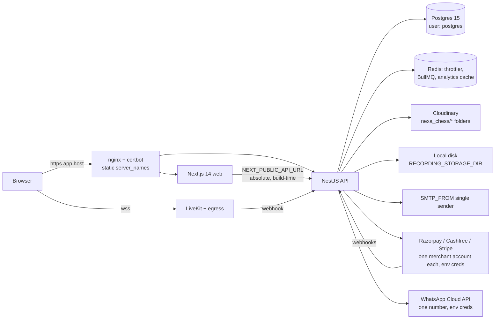
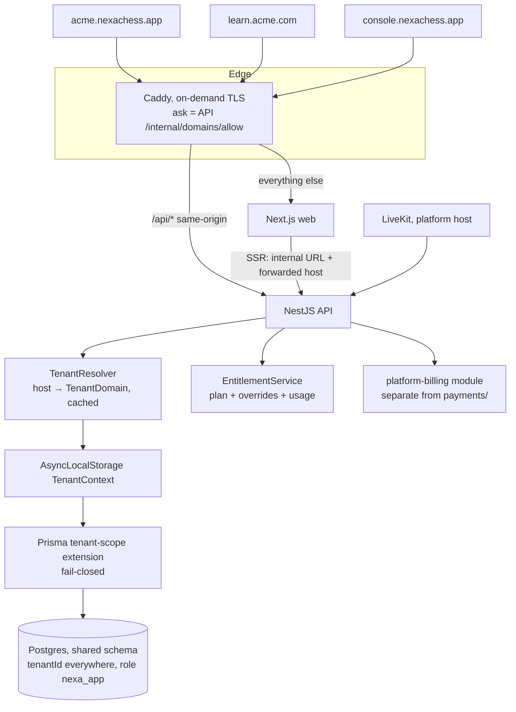

# Multi-tenant white-label SaaS — Phase 0 assessment and Phase 1 design

Status: **proposal, awaiting owner sign-off** (written 2026-10-17). Nothing here is
implemented. No application file, schema or migration has been changed. The
decisions in §N block Phase 2.

Contents: A current state · B target architecture · C entity ownership matrix ·
D schema and migration · E auth and isolation · F branding · G SaaS billing and
entitlements · H onboarding and domains · I platform admin · J migrating the
existing academy · K threat model and tests · L roadmap · M effort · N owner decisions.

---

## Summary

1. **Today the app is single-tenant by design.** No academy or tenant id exists
   anywhere. `ADMIN` and `SUPER_ADMIN` see every row (`docs/AUTHORIZATION.md`,
   "One academy, platform-wide admins"). Scale of the change: 125 Prisma models,
   ~1,600 Prisma call sites in 125 services, 516 routes in 57 controllers, 80
   raw-SQL calls in 24 files, 19 cron jobs, 9 global "singleton" settings tables
   and ~12 globally-unique business keys.
2. **Three features are already white-label at the single-tenant level.** Invoice
   seller details (`InvoiceSettings`), board appearance and typography each have
   an admin-editable singleton and a 3-layer resolver. Turning each singleton
   into a per-tenant row is most of the "branding" work for those areas.
3. **Name clash.** `Plan`, `Subscription`, `Entitlement`, `Order` and `Invoice` already
   mean *the academy bills its students*. SaaS billing (*the academy pays NexaChess*)
   must use separate tables and names (`PlatformPlan`, `TenantSubscription`, …) and a
   separate module. It must never be a second mode of `PaymentService`.
4. **Data migration can't wait for Phase 9.** Production is one live tenant,
   deployed continuously from `main`. So `tenantId` columns have to arrive already
   backfilled to the NexaChess tenant, in additive expand/contract steps, starting
   in Phase 2. The pasted plan puts migration at Phase 9; that ordering doesn't fit
   this repo.
5. **Custom domains break today's cookie and API model.** The web calls an absolute
   `NEXT_PUBLIC_API_URL` (baked in at build time) with `SameSite=lax` cookies shared
   across `api.`/`www.` subdomains. A customer domain like `learn.acme.com` calling
   `api.nexachess…` is cross-site, so the browser won't send the cookies. **Every
   tenant host must serve the API same-origin under `/api`.**
6. **The database connection bypasses row security.** The app connects as the
   `postgres` superuser (`docker-compose.yml`), so Postgres RLS would be silently
   skipped. Using RLS as defence in depth needs a dedicated non-superuser role first.
7. **Recommended shape:** one shared database and schema. `tenantId` goes on
   every tenant-owned table, child rows included. Enforcement has three layers:
   (1) a fail-closed Prisma extension driven by a request-scoped tenant context,
   modelled on the existing `soft-delete.extension.ts`; (2) composite foreign keys
   on core relations; (3) RLS later, under a non-superuser role. A
   two-tenant version of the existing cross-user integration suite is the gate.

---

## A. Current architecture assessment

| Area | What exists | Single-academy assumption |
|---|---|---|
| Stack | Turborepo; Next 14 App Router; NestJS 11; Prisma 6 / Postgres 15; Redis 7; LiveKit; one ARM64 VPS | One deployment = one academy |
| Identity | `User` with global `@unique email` / `username`; `role` enum on the user (`SUPER_ADMIN`, `ADMIN`, `COACH`, `STUDENT`); MFA, lockout, rotating refresh sessions | Role is global, not per organisation |
| Authz | No guards. Controllers pass the token string → `authenticateUser` → per-service `assertCanX` / `getXVisibilityWhere`. Admins get `{}` (everything) | `{}` would mean "every tenant" |
| Web gating | `middleware.ts` + `routeAccess.ts` read the role from the JWT payload | Fine as a routing hint. Needs no tenant knowledge |
| Soft delete | `$extends` query extension + `TrashRepository` | A precedent for a tenant-scope extension |
| Global settings (singletons) | `AttendancePolicy`, `LiveClassPolicy`, `ChessAppearanceSettings`, `TypographySettings`, `PuzzleScoringSettings` (id `"default"`), `InvoiceSettings` (id `"default"`), `PaymentSetting`, `MessagingRule` (unique per `event`), `OfflinePaymentMethod` (unique `key`) | One row for everyone |
| Number sequences | `InvoiceSequence`, `CreditNoteSequence`, `PayslipSequence` keyed by year only | One gap-free series. Legally each seller (GSTIN) needs its own |
| Student billing | `Plan → Order → Payment → Entitlement`, `Subscription`, `Invoice`, `CreditNote`, `Discount`; provider creds and seller name from env (`RAZORPAY_*`, `PAYMENTS_SELLER_*`) | NexaChess is the only merchant |
| Payroll | `CoachCompensation*`, `PayrollPeriod` unique on `(periodType, startDate, endDate)`, `Payslip` | One payroll calendar |
| Live class | `LiveSession.roomName = class_<classId>`; tokens only from the API; webhook `POST /webhooks/livekit` maps room → class | Room ids are cuids, so they're unique globally. Tenant would come from the class |
| Files | Cloudinary: avatars (public), PGNs (`nexa_chess/pgns`), invoices/payslips (`type: authenticated`); recordings on local disk with one `RECORDING_STORAGE_LIMIT_GB` | No tenant in paths or quotas |
| Jobs | 19 `@Cron` jobs under `JobLockService.runExclusive`. BullMQ is optional | Sweeps cover all rows; per-row config read from singletons |
| Caches | Analytics `cache.wrap` key = range + filters, **with no user and no tenant**. Stockfish cache keyed by FEN | Fine with one academy and admin-only analytics. With two tenants it **leaks data across tenants** |
| Raw SQL | 80 calls in 24 files, mainly analytics sections, activity history, puzzle catalogue/training, puzzle rush, job locks | Each one needs a hand-written tenant predicate |
| Branding (web) | `SITE_NAME = "Nexa Chess"` (`lib/site.ts`); `/academy` marketing site with hard-coded NexaChess content; ~62 source files mention the brand; CSS-variable `--rgb-*` theme tokens | One brand at build time |
| Email | One `SMTP_FROM`; brand strings in `mail.service.ts`, `messaging.format.ts`, MFA issuer | One sender |
| Ops | `deploy-production.sh`, image rollback, `pg_dump` backups of the whole database (also exposed in the admin UI as "Backup now") | A backup is a whole-platform object |
| Tests | Jest unit tests; integration suite with `auth-boundary`, `cross-user-access` (two mirror-image "worlds"), `admin-routes`, `route-auth.spec.ts`; Playwright e2e | The two-world harness is the natural base for two-tenant tests |

---

## B. Proposed multi-tenant architecture

### Hosts
- `<slug>.<platform-domain>`: every tenant gets one automatically.
- `<custom domain>`: optional, plan-gated. It must be verified before activation (§H).
- `console.<platform-domain>`: the platform admin console. It is not a tenant, and
  only platform staff can sign in there.
- The NexaChess tenant keeps its current production hostnames as verified domains,
  so nothing changes for existing users.
- LiveKit stays on one platform host. A WebRTC token carries no cookie, so it
  doesn't need to be same-origin.

### Request lifecycle
1. The edge proxy forwards `Host`. The API trusts `X-Forwarded-Host` only via the
   existing `TRUST_PROXY_HOPS`.
2. `TenantResolver` normalises the host (lowercase, strip the port and trailing
   dot, punycode) and looks it up in `TenantDomain` (status `ACTIVE`). Lookups are
   cached in-process and in Redis for 60s; a change invalidates the cache. An
   unknown host gets a 404 tenant-not-found page and never falls back to a
   default tenant.
3. This sets a **public context** `{ tenantId, source: "host" }`. That's enough for
   login, public demo pages, lead forms and branding.
4. `authenticateUser` also requires `session.tenantId === context.tenantId` and an
   `ACTIVE` membership, then upgrades the context to
   `{ tenantId, userId, role: membership.role }`.
5. The domain only names the tenant. Permission still comes from membership plus the
   existing per-service checks.

### Tenant and subscription state are separate
- `Tenant.status` is one of `PROVISIONING | ACTIVE | SUSPENDED | DEACTIVATED | PENDING_DELETION`.
- `TenantSubscription.status` is one of `TRIALING | ACTIVE | PAST_DUE | GRACE | CANCEL_SCHEDULED | EXPIRED | CANCELLED`.
- A single policy function `resolveTenantAccessMode(tenant, subscription)` returns
  `FULL | READ_ONLY | LOCKED`. It lives in `@nexa-chess/types`, in the same style
  as `class-availability.ts`.

---

## C. Entity ownership matrix (all 125 models)

Legend:
- **P**: platform-wide, no `tenantId`.
- **T**: tenant-owned, gets a `tenantId NOT NULL` column.
- **T\***: a tenant-owned singleton that becomes one row per tenant.
- **F**: tenant-owned financial or immutable record (`onDelete: Restrict`, never edited).
- **U**: global user identity, linked to tenants through membership.

| Domain | Models | Class | Notes |
|---|---|---|---|
| Identity | `User` | U | Email stays globally unique (§N-3). The `role` column becomes legacy; the effective role comes from `TenantMembership` |
| | `UserMfa`, `UserChessAppearancePreference`, `UserTypographyPreference`, `ExternalChessAccount` | U | Belong to the person, not the academy |
| | `AuthSession`, `PasswordResetToken`, `EmailVerificationToken` | T | A session/token is bound to the tenant it was issued on. Reset links are built from the tenant's primary domain, **never from the `Host` header** |
| | `StudentProfile`, `CoachProfile` | T | `userId @unique` holds while v1 allows one membership per non-platform user (§N-3). Later: `(tenantId, userId)` |
| | `AccountDeletionRequest` | T | Handled by the tenant admin. Platform staff see it for support |
| Org structure | `Batch`, `BatchCoach`, `BatchStudent`, `TrashAuditLog` | T | Composite FK `(tenantId, batchId)` |
| Scheduling | `CoachClass`, `BatchClassSchedule`, `BatchClassScheduleRule`, `BatchScheduleException`, `ClassChangeRequest` | T | |
| Demo / marketing | `DemoSchedule` (`slug @unique` → `(tenantId, slug)`), `DemoClassRegistration`, `VisitorSession`, `Lead`, `LeadActivity`, `LeadNote` | T | Public forms resolve the tenant from the host |
| Attendance | `ClassAttendance`, `AttendanceLog`, `CoachAttendance`, `CoachAttendanceLog` | T | |
| | `AttendancePolicy` | T\* | |
| Live class | `LiveSession`, `LiveClassPull`, `LiveClassWaitingParticipant`, `LiveClassScreenShareRequest`, `LiveChatMessage`, `LiveClassPuzzleAssignment`, `LiveClassLeaderboardAdjustment`, `LiveClassSimul`, `LiveClassSimulGame`, `LiveClassMatchRound`, `LiveClassMatchGame`, `LiveClassMatchChallenge`, `LiveClassMovePoll`, `LiveClassMovePollAnswer`, `LiveClassPuzzleRush`, `LiveClassPuzzleRushEntry`, `LiveClassToolState`, `LiveClassChapter`, `LiveClassActivityQueue`, `LiveClassActivityQueueItem` | T | `scopeKey` uniques (`LiveClassToolState`, `LiveClassChapter`) become tenant-prefixed |
| | `LiveClassPolicy` | T\* | |
| | `LiveClassPreset` | T | Scope `ORG` now means "this tenant". A platform-provided preset is a new `SYSTEM` scope with no `tenantId` (or stays in code) |
| Appearance | `ChessAppearanceSettings`, `TypographySettings` | T\* | The admin layer of the 3-layer resolver becomes "tenant admin" |
| Courses | `Course`, `CourseModule`, `StudentCourseProgress`, `StudentModuleProgress`, `Practice`, `StudentPractice` | T | |
| Assignments | `Assignment`, `AssignmentBatch`, `StudentAssignment`, `StudentAssignmentAttempt`, `AssignmentPuzzle` | T | |
| Puzzles | `PuzzleTopic`, `Puzzle`, `PuzzleAttempt`, `PuzzleRatingChange`, `StudentProgress` | T | `Puzzle` visibility `GLOBAL` now means tenant-wide. `(source, sourceId)` unique → `(tenantId, source, sourceId)`. Whether NexaChess's own library is offered to other tenants is §N-6 |
| | `PuzzleScoringSettings` | T\* | id `"default"` → keyed by `tenantId` |
| | `LichessPuzzle`, `LichessCatalogueRelease` | P | Shared read-only catalogue. Each tenant's `Puzzle` copies reference it |
| Revision | `RevisionItem`, `RevisionReview` | T | |
| Games | `ChessGame`, `GameAnalysis`, `GameAnalysisSide` | T | `sourceKey @unique` and `(ownerId, contentHash)` get `tenantId` added. `GAME_ANALYSIS_DAILY_LIMIT` becomes a per-tenant quota |
| Communication | `Notification`, `Announcement`, `Conversation`, `ConversationMember`, `ChatMessage`, `MessageDelivery` | T | `Conversation.batchId/directKey @unique` become tenant-scoped. `MessageDelivery.(channel, dedupeKey)` gets `tenantId` added |
| | `MessagingRule` | T\* | `event @unique` → `(tenantId, event)` |
| Feedback | `FeedbackForm`, `FeedbackResponse`, `FeedbackAnswer` | T | |
| Analytics | `StudentActivity`, `AnalyticsEvent`, `RecordingWatchProgress` | T | |
| | `StorageSnapshot` | T + P | Splits into a per-tenant usage snapshot plus a platform total. `capturedDate @unique` → `(tenantId, capturedDate)` |
| Student billing | `Plan` (`code @unique`), `Order` (`orderNumber`, `idempotencyKey`), `Payment`, `PaymentAttempt`, `PaymentWebhookEvent`, `Refund`, `Subscription`, `Entitlement`, `Invoice` (`number`), `InvoiceAuditLog`, `CreditNote` (`number`), `BillingProfile`, `Discount` (`code`), `DiscountRedemption`, `ManualPaymentRecord` | F | Each business key becomes `(tenantId, key)`. Provider ids (`provider, providerPaymentId`) get `tenantId` added once tenants bring their own merchant accounts |
| | `InvoiceSettings`, `PaymentSetting`, `OfflinePaymentMethod` | T\* | Seller identity moves out of `PAYMENTS_SELLER_*` env into the tenant row |
| | `InvoiceSequence`, `CreditNoteSequence` | F | Primary key `year` → `(tenantId, year)`. Required for a gap-free series per seller |
| | `PaymentProviderEvent` | T | Provider-health samples per tenant merchant account. The platform aggregates them |
| Payroll | `CoachCompensationProfile`, `CoachCompensationRate`, `PayrollRule`, `PayrollPeriod` (unique → `+tenantId`), `CoachPayrollRecord`, `PayrollAdjustment`, `CoachPayout`, `Payslip` (`documentNumber`) | F | |
| | `PayslipSequence` | F | `(tenantId, year)` |
| Infrastructure | `JobLock`, `ProcessedWebhookEvent` | P | LiveKit event ids are globally unique |

**Child rows get their own `tenantId`, not just the root.** Three reasons:

1. The Prisma extension can then filter any model without a join.
2. RLS policies stay one line each.
3. Composite FKs `(tenantId, parentId) → parent(tenantId, id)` on core
   relations make a cross-tenant link impossible at the database level, even if
   application code is wrong.

### New models (all P, except where noted)

- `Tenant`: id, slug (unique, reserved-word list), name, status, primaryDomainId, timezone, country, currency, createdAt.
- `TenantDomain`: hostname (unique, normalised), tenantId, kind `SUBDOMAIN | CUSTOM`, status `PENDING | VERIFIED | ACTIVE | FAILED | REMOVED`, verificationToken, verifiedAt, lastCheckedAt.
- `TenantMembership`: (userId, tenantId) unique, role `OWNER | ADMIN | COACH | STUDENT` (plus `PARENT` later), status, invitedById.
- `PlatformStaff`: userId, role `PLATFORM_ADMIN | PLATFORM_SUPPORT`. MFA always required.
- `TenantBranding` (T\*): validated JSON settings, draft and published versions, asset references.
- `PlatformPlan` + `PlatformPlanVersion`: the price and limits a subscription signed up on are frozen in a version, so later price changes don't silently re-price existing customers.
- `TenantSubscription`, `TenantSubscriptionEvent`: an append-only log of state transitions, each recording its source (webhook, reconcile, admin, system).
- `PlatformOrder`, `PlatformPayment`, `PlatformInvoice`, `PlatformWebhookEvent`: never shared with the student-billing tables.
- `TenantEntitlementOverride`: enterprise or negotiated limits.
- `TenantUsage`: counters per metric.
- `TenantPaymentCredential` (T): AES-256-GCM encrypted, using the same approach as `UserMfa`.
- `TenantOnboarding` (T): step states.
- `PlatformAuditLog`.
- `SupportAccessGrant`.

Each new model needs its getter in `prisma.service.ts` (CLAUDE.md §7 rule 1).

---

## D. Schema change and migration approach

Every step is additive, so images built before the step keep working after it.
That's required because rollback restores images and never reverses migrations.

| Step | Migration | App code at that point |
|---|---|---|
| D1 | Create `tenants`, `tenant_domains`, `tenant_memberships`, `platform_staff`. Insert the NexaChess tenant with a fixed id (`tenant_nexa`) and its current production hostnames as `ACTIVE` domains. Create one membership per existing user, mapping `role` 1:1 (`SUPER_ADMIN` → `OWNER`, §N-4) | Unchanged |
| D2 | Add `"tenantId" TEXT DEFAULT 'tenant_nexa'` (nullable) to every T/T\*/F table. Backfill in batches for large tables (`puzzle_attempts`, `attendance_logs`, `analytics_events`, `message_deliveries`, `live_chat_messages`) | Old code still inserts without `tenantId`, and the default covers it |
| D3 | Deploy code that always sets `tenantId` from context (extension in **audit mode**: it logs, doesn't throw, when context is missing) | Watch logs until there are no missing-context hits |
| D4 | Set `NOT NULL`, add indexes `(tenantId, …)` that mirror the existing hot indexes, add composite uniques **next to** the old global ones, add composite FKs on core relations | Extension switches to **enforce** mode |
| D5 | Drop the old global uniques (`plans.code`, `invoices.number`, `messaging_rules.event`, …) and the `'tenant_nexa'` default | Second tenant allowed only after this |

A partial unique index `WHERE "isDeleted" = false` (soft-deletable models)
gains `tenantId` as its leading column. The trash checklist in `README.md` gains a
tenant step.

---

## E. Authentication, authorization and isolation

### Identity and roles
- **Keep `AuthenticatedUser.role` as the effective role.** `authenticateUser` loads
  the membership for `context.tenantId` and returns `{ ...user, role: membership.role, tenantId }`.
  The ~125 services' existing `user.role` checks then keep working unchanged.
  This is the main reason the migration is tractable.
- Mapping: `SUPER_ADMIN` becomes `OWNER`; `ADMIN`, `COACH` and `STUDENT` map
  across unchanged. Platform powers come only from `PlatformStaff`, never from a
  tenant role. An `OWNER` is not platform staff.
- Login on a tenant host looks up the user by email (global). It succeeds only if an
  `ACTIVE` membership in that tenant exists. Otherwise it returns the same generic
  error as a wrong password, so membership elsewhere isn't revealed. Lockout, MFA
  and throttles are unchanged.
- Roles change only through tenant-admin endpoints. Rules: nobody edits their own
  role, `OWNER` transfer needs re-authentication with password and MFA plus a
  notice to the old owner, and the last `OWNER` can't be removed. These mirror
  the existing `SUPER_ADMIN` rules.
- Cookies become host-only per tenant host. `COOKIE_DOMAIN` auto-derivation is
  dropped for tenant hosts, which stops a session on `acme.nexachess.app` from
  being readable on `beta.nexachess.app`. The access token's `sessionId` →
  `auth_sessions.tenantId` check is the second lock.

### Tenant scoping in the data layer
1. **TenantContext**: an AsyncLocalStorage store set by the resolver middleware,
   upgraded in `authenticateUser`, and explicitly entered by jobs via
   `runInTenant(tenantId, fn)`.
2. **Prisma `tenantScope` extension**: for models in `TENANT_MODELS`:
   - It adds `tenantId` to `where` on reads, updates, deletes and counts, and to
     `data` on create/upsert/createMany. `findUnique` is handled the same way
     `soft-delete.extension.ts` already handles it.
   - With no context, it **throws** (fail closed).
   - `prisma.asPlatform(reason)` is the only bypass. It's grep-able and
     restricted to an allow-list of call sites (platform console, global sweeps).
   - Known Prisma limit: nested writes don't run the extension for the child
     model. The `NOT NULL` column and composite FKs catch these, and the
     extension requires an explicit `tenantId` in nested `create` payloads.
3. **Raw SQL** (80 calls in 24 files): each one gets an explicit
   `"tenantId" = ${tenantId}`. A unit test fails any new `$queryRaw` file that isn't
   on a reviewed list, the same way `route-auth.spec.ts` works.
4. **RLS (Phase 3b, defence in depth)**:
   - Create a `nexa_app` role (`NOSUPERUSER NOBYPASSRLS`) for the API, and keep
     `postgres` for migrations only.
   - Add policies of the form `tenant_id = current_setting('app.tenant_id', true)`.
     The extension sets that value per transaction.
   - Measure the per-query transaction overhead first. If it's too high, apply RLS
     only to F tables and identity tables.
5. **Visibility helpers** (`getXVisibilityWhere`) stay as they are. Admin `{}` is
   now safe because the extension adds the tenant filter.

### Asynchronous and realtime paths
- **Crons**: global sweeps read rows under `asPlatform` and then process each
  row inside `runInTenant(row.tenantId)`, so per-tenant config (messaging rules,
  attendance policy, invoice settings) resolves for the right tenant.
- **BullMQ**: every payload carries `tenantId`, and the worker checks it against the
  row it loads. A mismatch is dropped and reported. The `jobId` stays row-derived.
- **Caches**: the analytics cache key gains `tenantId` (that's a must-fix in
  Phase 3). The Stockfish FEN cache stays global because it holds no personal data.
  Every new `cache.wrap` key needs a tenant component, enforced by a lint rule or
  helper.
- **LiveKit**:
  - Room names become `t_<tenantId>_class_<classId>`, which makes ops and
    webhooks easy to read.
  - Token issuance already checks class access. It now also checks
    `class.tenantId === context.tenantId`.
  - The webhook derives the tenant from the `LiveSession` row, never from the
    packet. A per-tenant concurrent-room quota is checked at room start.
- **Throttling**: the existing keys plus a per-tenant bucket, so one tenant can't
  use up shared capacity (Stockfish, egress).
- **Files**:
  - Cloudinary paths become `tenants/<tenantId>/…`. The `nexa_chess/…` paths stay
    valid for the NexaChess tenant's existing assets.
  - Recordings go under `<RECORDING_STORAGE_DIR>/<tenantId>/`, with a quota per tenant.
  - The existing download-time checks (signed stream tokens, Cloudinary
    `authenticated` downloads) gain the tenant comparison.
  - PGN uploads move from public to `authenticated`.

---

## F. White-label branding

**v1 scope:** academy name, logo (light/dark), favicon, primary/secondary colour,
font from the existing `FONT_CATALOG`, login-screen image, contact details,
footer/legal links, SEO title/description, email sender display name and reply-to,
invoice/payslip seller block (from the per-tenant `InvoiceSettings`), board
appearance and typography defaults (existing resolvers, now per tenant).

**How it renders:**
- The root layout's `generateMetadata` and the `<html>` element read a cached
  `GET /api/tenant/public-config` resolved by host.
- Brand colours are injected server-side as `--rgb-*` triplets. They must stay
  triplets, otherwise Tailwind `/opacity` utilities produce no CSS.
- No customer CSS or JS is ever executed. Colours are validated as hex, converted
  server-side, and **checked against WCAG AA contrast** on `app-surface` and
  `app-background`. A failing colour is rejected with an explanation.
- The draft/publish/reset flow uses a preview route that renders the draft for the
  tenant admin only.

**Assets:** PNG/JPEG/WebP/SVG. SVG is sanitised or rasterised (§N-9). Size and
dimension limits go through `RequireAccessTokenInterceptor` + multer `limits`,
stored under `tenants/<id>/branding/`. Logos are public by nature; that's fine.

**Hard-coded brand:** ~62 files mention NexaChess.
- `SITE_NAME` and the API strings (mail, MFA issuer, messaging format, invoice
  and payslip PDFs) read the tenant name.
- The MFA issuer should be `"<Academy> (NexaChess)"`, so authenticator apps stay
  unambiguous.
- `/academy` (the current marketing site) stays as the NexaChess tenant's custom
  landing page. Other tenants get a generic, block-based landing page driven by
  `TenantBranding` content (hero, programmes, contact, demo booking) built from
  the existing section components.

**Email:**
- v1 sends from the platform domain as
  `"Acme Chess" <noreply@mail.nexachess.app>`, with `Reply-To` set to the tenant's
  address. That keeps deliverability (SPF/DKIM) under platform control.
- Sending from the customer's own domain needs a transactional provider with
  per-domain DKIM (SES, Postmark). That's a later plan feature (§N-8).

---

## G. SaaS billing and entitlements

### Module boundary
`apps/api/src/platform-billing/` with its own tables and webhook routes
(`/platform-billing/webhooks/<provider>`, added to the origin-check exempt list). It
may reuse provider adapters from `payments/providers/` through a narrow interface.
That needs a written exception to the "no adapter outside `payments/providers/`"
rule, or the adapters move to a shared `providers` package. It never touches
`PaymentService.applyProviderState`, student `Entitlement`s or student invoices.
Money stays in integer minor units via `toMinorUnits`.

### Plans
`PlatformPlan` defines:
- Monthly and annual prices per currency.
- Trial days.
- A feature set (keys from one catalogue in `@nexa-chess/types`).
- Limits: `students`, `coaches`, `concurrentLiveRooms`, `liveMinutesPerMonth`,
  `recordingStorageGB`, `gameAnalysesPerDay`, `whatsappMessagesPerMonth`,
  `customDomains`.
- Branding level, support tier, grace days.

Starter/Growth/Business/Enterprise are seed data, not code.

### State machine
Allowed transitions: `TRIALING → ACTIVE | EXPIRED`;
`ACTIVE → PAST_DUE | CANCEL_SCHEDULED`; `PAST_DUE → ACTIVE | GRACE`;
`GRACE → ACTIVE | EXPIRED`; `CANCEL_SCHEDULED → ACTIVE | EXPIRED`;
`EXPIRED → ACTIVE` (resubscribe).

Every transition goes through one function, `applySubscriptionTransition`. It has a
rank or allowed-transition guard, an idempotent `PlatformWebhookEvent (provider, eventId)`,
and appends a `TenantSubscriptionEvent`. A browser success callback only
triggers a provider read (reconcile). It never grants anything, the same rule
as student payments.

### Access policy (proposed default, §N-5)

| Subscription | Access mode | Effect |
|---|---|---|
| TRIALING / ACTIVE / CANCEL_SCHEDULED | FULL | |
| PAST_DUE (≤ grace days) | FULL | Owner banner + email |
| GRACE | READ_ONLY | Sign-in, view, export and recordings work. No new students, classes, live rooms or student payments |
| EXPIRED / tenant SUSPENDED | LOCKED for members; owner can sign in to pay or export | Data kept. Deletion only through the tenant-deletion workflow (§K) |

### Enforcement
`EntitlementService` (platform) offers three checks:
- `assertFeature(tenantId, key)`
- `assertWritable(tenantId)`
- `reserve(tenantId, metric, n)`

`reserve` is an atomic conditional `UPDATE tenant_usage SET used = used + n WHERE used + n <= limit`,
using the codebase's existing claim pattern. Zero rows updated means a 402/409 with
a typed error, so concurrent requests can't go over a hard limit. Counters are
reconciled nightly from real counts to repair drift.

- A **downgrade** never deletes anything. Resources over the limit stay readable;
  only creates are blocked.
- **Gate placement:** create-student/coach (`UserService`), class start
  (`LiveClassService` lifecycle), recording start, analysis enqueue, WhatsApp
  dispatch, custom-domain add, payroll/analytics/payments module entry.

### Two separate money flows
1. Academy → NexaChess: `platform-billing`, the platform's merchant account.
2. Student → academy: the existing `payments/`.
   - **v1:** NexaChess stays the only tenant with online student payments
     (env credentials). Other tenants use offline/manual payments.
   - **v2:** each tenant connects its **own** Razorpay/Cashfree/Stripe account.
     Credentials are encrypted in `TenantPaymentCredential`. Webhooks go to
     `/payments/webhooks/<provider>/<tenantKey>` and are verified with that
     tenant's secret.
   - The platform never collects money on a tenant's behalf. Doing so would make
     NexaChess a payment aggregator, which is a regulatory question (§N-7).

---

## H. Onboarding and domains

### Onboarding

| Step | What happens | Notes |
|---|---|---|
| 1 | Sign up or sign in on the platform marketing site | |
| 2 | Choose academy name and slug | Reserved words and existing hosts are rejected |
| 3 | Choose plan, or start a trial | One trial per verified owner email and per payment fingerprint |
| 4 | Create the tenant, owner membership, a `{slug}.platform` domain and default settings rows | One transaction with an idempotency key, so a double submit returns the same tenant |
| 5 | Branding | Resumable; progress kept in `TenantOnboarding` |
| 6 | Optional custom domain | Resumable |
| 7 | Invite admins and coaches | Resumable |
| 8 | CSV import of students | Resumable; reuses user-creation validation and consumes `reserve(students)` |
| 9 | Settings | Resumable |
| 10 | Readiness checklist | Resumable |
| 11 | Publish | The landing page goes live |

### Custom domains
1. The owner adds `learn.acme.com`. Hostnames under the platform domain, IP
   addresses, and hosts already claimed (any status other than `REMOVED`) are
   rejected.
2. The owner creates a CNAME to `edge.<platform>` and a TXT record
   `_nexa-verify.learn.acme.com = <token>`.
3. A verifier job resolves both and marks the domain `VERIFIED`.
4. Caddy's on-demand TLS `ask` endpoint returns 200 only for `VERIFIED` or `ACTIVE`
   hosts, so certificates can't be issued for arbitrary hosts. Rate limits apply.
5. The first successful TLS handshake plus a health probe → `ACTIVE`.
6. Re-verification runs daily. Repeated failures move the domain to `FAILED`, it is
   then served with a notice, and the owner is emailed.
7. Removing a domain → `REMOVED`, and the hostname is held for 30 days before it can
   be claimed again. That stops another tenant from immediately taking over
   bookmarked links.
8. A canonical redirect goes from the subdomain to the custom domain. Redirect
   targets are **only** that tenant's active domains, never request input.

**Infrastructure change:** nginx + certbot with static `server_name`s can't issue
certificates for customer domains on demand. Two options, §N-1:
- Switch the edge to Caddy, on the same VPS.
- Use Cloudflare for SaaS custom hostnames, keeping LiveKit outside Cloudflare's
  proxy.

Either way, the web build must call `/api` relatively. That means removing the
absolute `NEXT_PUBLIC_API_URL` from 5 files, with SSR using an internal URL plus
the forwarded host. The `next.config.mjs` CSP gets `connect-src 'self' <livekit host>`.

---

## I. Platform admin (console host)

- **Tenants:** directory, detail, lifecycle actions (suspend, reactivate,
  deactivate, schedule deletion), plan overrides.
- **Billing:** plans, plan versions, subscriptions, failed payments and
  reconciliation queue, platform invoices.
- **Usage and quotas:** per tenant, plus the platform total (storage, live minutes,
  Stockfish lane).
- **Operations:** domain states, provisioning failures, job health, backups
  (whole-database `pg_dump` moves here from the tenant admin UI).
- **Business analytics:** aggregates only (MRR, churn, active tenants). It never
  shows tenant personal data by default.
- **Audit:** `PlatformAuditLog` for every console action.
- **Support access:**
  - A `SupportAccessGrant` is requested by staff with a reason, optionally approved
    by the tenant owner (§N-10), and lasts 1 hour by default.
  - It is **read-only by default**.
  - Every request made under it is logged with the grant id. A banner is shown,
    and the tenant owner can see the grant history.
  - Writes need a separate, explicitly approved grant type.
- **Who can sign in:** only `PlatformStaff`, with MFA always enforced. Tenant
  `OWNER`/`ADMIN` accounts can't sign in to the console.

---

## J. Migrating the existing academy

| # | Item | Plan |
|---|---|---|
| 1 | Inventory | Every T/T\*/F table in §C. All existing rows are unambiguously NexaChess, because only one academy has ever existed. The ambiguous items are **P vs T** classification only: the Lichess catalogue (P), NexaChess's `GLOBAL` puzzles (T, owned by NexaChess, §N-6), system presets, and `StorageSnapshot` (split) |
| 2 | Backfill | The D2 column default plus a batched `UPDATE … WHERE "tenantId" IS NULL` for large tables, run under `JobLockService` |
| 3 | Order | Tenant → domains → memberships → roots (batches, users' profiles, plans) → children. A column default makes ordering non-critical until D4 |
| 4 | Constraints | Composite uniques added next to the old ones (D4) and the old ones dropped (D5) only after a count check shows no duplicates within a tenant (trivially true for one tenant) |
| 5 | Roles | 1:1 into memberships. Existing `SUPER_ADMIN`s become `OWNER`. The person running the platform also gets a `PlatformStaff` row |
| 6 | Sequences | `InvoiceSequence`/`CreditNoteSequence`/`PayslipSequence` rows get `tenantId = tenant_nexa`. Numbering continues unchanged, with prefixes from `InvoiceSettings` |
| 7 | Financial history | Never rewritten. Only the `tenantId` column is added. Totals are verified before and after (sum of `payments.amount` by status, invoice count/sum, payroll totals) |
| 8 | Domain and branding | Current hostnames → `TenantDomain ACTIVE`. Current `InvoiceSettings`, appearance and typography rows become NexaChess's tenant rows |
| 9 | Rehearsal | Restore the latest production backup into a staging DB (`docs/DATABASE_RESTORE.md`), run D1–D5, run the verification script (row counts per table, FK integrity, financial totals, a sample of logins), and run the e2e suite against staging |
| 10 | Rollback | D1–D4 are additive: rolling back an image leaves extra columns that old code ignores. D5 (dropping global uniques) is the only point of no return. It ships alone, after a full backup, once the new code has been stable for a release cycle |
| 11 | Compatibility | The `tenant_nexa` default stays until D5, so any old image that is still running keeps writing valid rows |

---

## K. Threat model and test strategy

| Threat | Control | Test |
|---|---|---|
| Cross-tenant IDOR/BOLA with known ids | Extension adds `tenantId` to every query; composite FKs | **Two-tenant cross-access suite**: `world.ts` builds two worlds in **two tenants** (the existing mirror-image design). Every existing cross-user row is run cross-tenant, including admin → other tenant |
| Session replayed on another tenant's host | `auth_sessions.tenantId` must equal the resolved tenant; host-only cookies | Auth-boundary: a token minted on tenant A's host is a 401 on B's host |
| Host-header injection / spoofed `X-Forwarded-Host` | Trust only via `TRUST_PROXY_HOPS`; links built from `Tenant.primaryDomain` | Reset email for tenant A never contains a host taken from the request |
| Domain takeover / unverified claim | TXT verification, `ask` endpoint, 30-day hold after removal, platform-host blocklist | Unit tests on the domain state machine; `ask` rejects unknown hosts |
| Role escalation / self-join | Membership writes only through admin endpoints; last-owner rule; no self-role edit | Integration: coach promoting self, student joining another tenant |
| Tenant owner reaching platform controls | `PlatformStaff` separate from tenant roles; console host only | `admin-routes.int-spec.ts` extended: every `/platform/*` route is a 403 for every tenant role, including `OWNER` |
| Subscription / quota bypass | Server-side `EntitlementService`; atomic `reserve` | Parallel create-student requests at limit − 1 → exactly one succeeds |
| Forged payment success | Browser callback only triggers a reconcile read | Callback without a provider capture grants nothing |
| Webhook replay / duplication | `(provider, eventId)` unique; signature on raw bytes | Same event twice → one transition |
| Shared-cache leak | `tenantId` in every cache key | Same analytics query in tenants A and B returns different payloads |
| Cross-tenant jobs | Payload `tenantId` checked against the row; `runInTenant` | Job with a mismatched tenant is dropped |
| File / export leak | Tenant prefix; download-time check | Tenant A's user can't fetch B's invoice, payslip or recording via a known id |
| LiveKit token misuse | Token only after class + tenant check; tenant-prefixed rooms; webhook removal on join | Student of A requests a token for B's class → 404 |
| Support access abuse | Time-boxed, read-only, audited grants | Expired grant → 403; every request logged |
| Missing scope in new code | Fail-closed extension; schema test: every model not on the `PLATFORM_MODELS` list has `tenantId`; reviewed-raw-SQL list | Unit test reads the Prisma DMMF and fails on a new unscoped model |
| Tenant deletion | `PENDING_DELETION` → 30-day hold → export offered → hard delete except F tables, which are kept for the statutory period (§N-11) | Purge leaves invoices/payroll; integration test |

**Privacy:** students are minors. Platform analytics are aggregate-only, Sentry stays
`user.id` + role (+ `tenantId` tag), and support access is logged. The privacy
export gains tenant context.

---

## L. Phased roadmap

Each phase ends green on `typecheck`, `lint`, unit tests and integration tests,
with docs updated and a checkpoint with the owner. Nothing is committed or
deployed without explicit approval.

| Phase | Scope | Depends on | Acceptance |
|---|---|---|---|
| 0 | This assessment | — | Owner review |
| 1 | Decisions in §N signed off; this doc amended | 0 | §N all answered |
| 2 | **Foundation**: D1–D3; TenantContext; host resolver (the NexaChess hosts resolve to `tenant_nexa`); memberships; session tenant binding; `authenticateUser` returns the membership role; extension in audit mode | 1 | Zero behaviour change for NexaChess users (full e2e green on staging); no missing-context log hits for one release |
| 3 | **Isolation**: D4; extension enforcing; per-tenant singletons and sequences; composite uniques; 80 raw-SQL calls; crons/BullMQ/caches/files/LiveKit; two-tenant integration suite; DMMF schema test. 3b: `nexa_app` role + RLS on F and identity tables | 2 | A second seeded tenant in staging can't see or change any NexaChess row via any of the 516 routes; suite green |
| 4 | **Branding**: `TenantBranding`, public config, SSR theming, assets, previews, brand strings out of code, email sender | 3 | Two tenants render different brands from one build; contrast validation; no customer CSS/JS |
| 5 | **SaaS billing + entitlements**: `platform-billing`, plans/versions, state machine, webhooks, reconcile, `EntitlementService`, usage counters, gates | 3 | Forged callbacks are no-ops; duplicate webhooks are safe; quota race test; downgrade keeps data |
| 6 | **Onboarding + domains**: wizard, invites, CSV import, domain verification, edge proxy switch, relative `/api` | 4, 5 | Duplicate submit makes one tenant; unverified domain gets no certificate; custom domain serves the tenant with working login |
| 7 | **Platform console**: tenants, billing ops, usage, audit, support grants, backups moved | 5 | Tenant roles can't reach `/platform/*`; grants expire and are logged |
| 8 | **Feature adaptation leftovers**: tenant-owned payment credentials, per-tenant WhatsApp (if chosen), landing-page blocks, tenant data export, tenant deletion workflow | 6, 7 | Per-feature tests from §K |
| 9 | **D5 contract + staging rehearsal** on a restored production backup | 3–8 | Row counts, FK integrity and financial totals match; rollback drill done |
| 10 | **Controlled rollout**: one pilot academy, monitoring, then general availability | 9 | Pilot runs a month with no isolation incident |

---

## M. Effort (rough, with assumptions)

Assumes one senior full-stack engineer working with AI assistance, the current test
harness, and decisions in §N made promptly. These are ranges, not commitments.
The biggest uncertainty is Phase 3: how many of the ~1,600 call sites need hand
changes beyond what the extension covers, mainly nested writes and raw SQL.

| Phase | Estimate |
|---|---|
| 1 | 2–4 days (owner decisions) |
| 2 | 2–3 weeks |
| 3 (+3b) | 5–8 weeks (+1–2) |
| 4 | 2–3 weeks |
| 5 | 3–5 weeks |
| 6 | 3–4 weeks (domains + edge change carry infrastructure risk) |
| 7 | 2–3 weeks |
| 8 | 3–5 weeks (depends on §N-7/8) |
| 9–10 | 2–3 weeks plus a pilot month |
| **Total** | **~6–9 months** to general availability. A first paying tenant on subdomains with manual billing is possible after Phase 4 (~3 months) |

**Faster interim option, if a customer arrives early.** Run them as a separate
deployment of the *same* image: their own compose stack and database, configured
through the existing admin singletons (invoice seller, appearance, typography) and
env (brand, payment credentials). That gives perfect isolation in days, at the cost
of per-customer operations. It doesn't fork the code. It's a stopgap, not the
target.

---

## N. Decisions and inputs needed from the owner

1. **Edge / TLS for custom domains:** Caddy on-demand TLS on the VPS, or
   Cloudflare for SaaS? Also the platform domain name, and DNS control for
   `*.platform` (wildcard certificate via DNS challenge).
2. **Hosting capacity:** one ARM64 VPS runs web, API, Postgres, Redis, LiveKit and
   egress. Multi-tenant live video needs a capacity plan: a separate LiveKit node,
   managed Postgres, or object storage for recordings instead of local disk.
3. **Identity:** keep email globally unique, with one membership per
   non-platform user in v1 (simplest and safest; a person can't join two academies
   with one email). Or allow multiple academies per identity now (an academy
   switcher, per-tenant profiles; +2–3 weeks)?
4. **Role mapping:** `SUPER_ADMIN` → tenant `OWNER`; which named person becomes
   `PLATFORM_ADMIN`? Is a `PARENT` role in scope (see `docs/PARENT_REPORTS.md`)?
5. **Lapsed-subscription policy:** grace days, and what `READ_ONLY` allows (do
   already-scheduled classes still run?).
6. **Content:** is NexaChess's puzzle library, courses or presets offered to other
   tenants as platform content (licensed, read-only), or kept private to the
   NexaChess tenant?
7. **Student payments for other tenants:** offline-only in v1, then
   bring-your-own merchant account? Confirm NexaChess must not collect on tenants'
   behalf (aggregator licensing).
8. **Email and WhatsApp:** platform sender with tenant reply-to (v1), and when to
   offer the tenant's own domain or WhatsApp Business number. Which transactional
   email provider?
9. **Branding limits:** SVG logos allowed (sanitise) or raster only; which
   capabilities are plan-gated (e.g. custom domain from Growth up, "Powered by
   NexaChess" removable from Business up)?
10. **Support access:** does a tenant owner have to approve each grant, or is it
    covered by the terms of service?
11. **SaaS billing:** provider and currency (Stripe Billing vs Razorpay
    Subscriptions), GST on platform invoices (NexaChess's GSTIN, B2B buyer GSTIN
    capture), retention period for financial records after a tenant is deleted.
12. **Legal:** tenant-facing terms, a data processing agreement (the tenant is the
    controller for its students' data), and how `features/legal/content.ts`
    becomes per-tenant.
13. **Process:** approve this doc's direction, then Phase 2 runs on a branch off
    `main` (or `dev`), with a checkpoint at the end of each phase.
