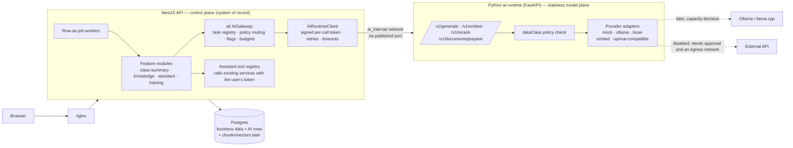

# AI foundation: architecture

Status: **proposal, not approved** (revision 2, 2026-10-19). Nothing here is
implemented. No application code, schema, migration, environment file or
running service has been changed. Revision 1 (same day) proposed a TypeScript-only
first step. Revision 2 adopts a NestJS + Python split, because the brief now
includes RAG ingestion, embeddings, reranking and retrieval evaluation, which
were revision 1's own trigger for a Python service (DECISIONS.md ADR-001).
Revision 3 (same day) corrected Phase 1 against the repository; this file now
defers every P1 detail to [`PHASE1_SPEC.md`](PHASE1_SPEC.md) (see its §0).

The AI documentation set:

| File | Purpose |
|---|---|
| `AI_FOUNDATION.md` (this file) | Audit, target architecture, every subsystem |
| [`DECISIONS.md`](DECISIONS.md) | ADRs: audit-backed, proposed, open owner decisions |
| [`ROADMAP.md`](ROADMAP.md) | Phases, dependencies, acceptance criteria, approvals |
| [`PHASE1_SPEC.md`](PHASE1_SPEC.md) | Smallest first implementation: contract v1.0, service auth, networking, tests, acceptance gates |
| [`RAG_POC.md`](RAG_POC.md) | Non-production RAG proof of concept |
| [`INFRASTRUCTURE_DECISION.md`](INFRASTRUCTURE_DECISION.md) | Deployment options, VPS facts, recommendation |

Labels used throughout:

- **[V]** verified in code, schema or on the box (read-only)
- **[P]** partial
- **[M]** missing
- **[U]** unknown, with how to resolve it
- **[R]** recommended (proposed, not approved)

Contents: 1 audit · 2 target architecture · 3 NestJS/Python boundary · 4 model
layer · 5 RAG · 6 assistant and tools · 7 chess intelligence · 8 Live Class AI ·
9 safeguarding · 10 data model and tenancy · 11 security · 12 observability and
testing · 13 open questions

---

## 1. Current-state audit

### 1.1 Platform

| Area | Finding | Evidence |
|---|---|---|
| AI code | **None [V].** No provider SDK, embeddings, vector store or Python service exists | Repo-wide grep for openai/ollama/openrouter/pgvector/embedding/fastapi returns nothing in `apps/` or `packages/` |
| Backend | NestJS 11 (Express 5). One folder per feature module [V] | `apps/api/src/*` |
| Auth | No guards. The controller passes the cookie token to the service, which calls `authenticateUser` (signature, type, `ACTIVE` user, live `auth_sessions` row). Roles are checked in `assertCanX`; rows are filtered by `getXVisibilityWhere` [V] | `auth/authenticate.ts`, `batch/batch.service.ts` |
| Auth safety nets | `route-auth.spec.ts` checks that every handler passes `request`. The integration suites `auth-boundary`, `cross-user-access` and `admin-routes` (which discovers admin routes automatically) cover access [V] | `common/security/`, `test/integration/access/` |
| Contract | Zod **4.4.3** in `packages/types`, with `API_ROUTES`. Zod 4 can emit JSON Schema with `z.toJSONSchema`, which is useful for a cross-language contract [V] | `packages/types/package.json` |
| Env | One Zod schema in `packages/config/src/api.ts`. Compose passes `${VAR:-default}` from the root `.env`. There is no secret manager [V] | |
| Frontend | Next 15 App Router. Each feature has `api/`, `hooks/` and `components/`. Route access is controlled in `routeAccess.ts` and `middleware.ts` [V] | `apps/web/src/features/*` |
| Jobs | **Row as job**: a database row is claimed with `FOR UPDATE SKIP LOCKED` and has a heartbeat, a stale sweep, a retry cap, checkpoints and requeue on shutdown. No Redis is needed. BullMQ is optional (only invoices use it) [V] | `game-analysis/game-analysis.worker.ts`, `queue/queue.module.ts` |
| Cron | `JobLockService.runExclusive(JOB_LOCKS.x)` [V] | `prisma/job-lock.service.ts` |
| Stockfish | An in-process pool with `interactive` and `background` lanes. Game analysis stores White-relative evaluations, classifications and tactics with version numbers [V] | `stockfish/stockfish.service.ts`, `game-analysis/` |
| Chess rules | All chess-rule code goes through the `common/chess/chess` (API) and `@/lib/chess` (web) wrappers. ESLint blocks importing `chess.js` directly [V] | CLAUDE.md §4 |
| Files | Cloudinary holds avatars, PGNs (`nexa_chess/pgns`, raw) and invoices. Recordings are MP4s on local disk [V] | `upload/upload.service.ts` |
| Logging | `nestjs-pino` with `x-request-id` (reused from the incoming request or generated). Paths are logged without query strings, and there is no body logging. Sentry uses `scrubSentryEvent` plus a restricted `dataCollection` [V] | `common/logging/logger.config.ts`, `instrument.ts` |
| Monitoring | Beszel hub and agent containers, Sentry. No metrics endpoint [V] | `docker stats` |
| CI/CD | `ci.yml` jobs: `changes`, `verify`, `migrations` (service image `postgres:15-alpine`) and `build`, on x86 `ubuntu-latest`. Deploy runs `docker compose up -d --build` on the ARM box. Rollback restores the `:last-good` image [V] | `.github/workflows/ci.yml`, `scripts/deploy-production.sh` |
| Staging | **None verified [U].** There is an isolated test stack recipe (`nexa_gen_int`, ports `:3100`/`:3101`) on the production box | Ask the owner (DECISIONS.md OD-11) |

### 1.2 Data relevant to AI (aggregate counts only; no row contents read)

| Source | State | Evidence |
|---|---|---|
| Classes | 52 ended in 30 days, averaging 76 minutes [V] | `live_sessions` |
| Class metadata | 137 of 149 classes have a title, topic or objectives. **0 have `notes`** [V] | `classes` |
| Puzzle attempts | 418 in 30 days; 256 library puzzles; 6.16M Lichess catalogue rows [V] | `puzzle_attempts`, `puzzles`, `lichess_puzzles` |
| In-class puzzles | 283 shared in 30 days [V] | `live_class_puzzle_assignments` |
| Board and moves | 22 chapters (PGN/treePgn), 4 class-board games in 30 days. `LiveSession.boardState` keeps only the last snapshot [P] | `live_class_chapters`, `chess_games` |
| Chat | 26 room/private live messages (10 private) and 4 persistent messages in 30 days [V] | `live_chat_messages`, `chat_messages` |
| Transcripts | **None [M]**. Recordings are MP4 room composites; 7 have ever completed; 1.2 GB on disk [V] | `live_sessions.recordingStatus`, `du` |
| Knowledge documents | **None [M]**. `CourseModule.contentType` is only `ASSIGNMENT` or `PUZZLE`; there are 0 courses and no upload path for documents or books | `schema.prisma`, `upload/` |
| Users | 20 students (minors), 6 coaches, 1 super admin [V] | `users` |

### 1.3 Tenancy

- **Single-tenant [V].** No `tenantId`, `academyId` or `organizationId` exists in
  the schema (125 models). `ADMIN` and `SUPER_ADMIN` get `{}` visibility.
  `Plan`/`Subscription` bill *students*, not academies. Isolation is per user
  and is tested.
- `docs/SAAS_MULTI_TENANCY.md` is a proposal, neither approved nor built. AI
  must not depend on it, but it must not obstruct it either (§10).

### 1.4 Infrastructure (re-verified read-only, 2026-10-19)

Full detail is in [`INFRASTRUCTURE_DECISION.md`](INFRASTRUCTURE_DECISION.md).

| Fact | Value |
|---|---|
| CPU | 2 × aarch64 Neoverse-N1 [V] |
| RAM | 11.6 GiB, 9.0 GiB available [V] |
| Disk | 127 GB free of 193 GB [V] |
| GPU | None [V] |
| Postgres | **15.18 on `postgres:15-alpine`; `pgvector` is not available** (`pg_available_extensions` has no `vector`). `pg_trgm` and `unaccent` are available but not installed. The database is 2.76 GB [V] |
| Collation | `en_US.utf8`, libc provider, on musl [V]. Moving to a Debian-based `pgvector/pgvector` image changes collation behaviour under 456 text-column index entries, so it would need a REINDEX. See INFRASTRUCTURE_DECISION.md §3 |
| OCI A1 capacity | `standard-a1-core-count` available 0 / used 2; `standard-a1-memory-count` available 0 / used 12 (AP-MUMBAI-1-AD-1). **No free second instance in the current limits [V]** |
| Recording cap | `RECORDING_STORAGE_LIMIT_GB=130` is larger than the 127 GB free. Actual use is 1.2 GB [V] |
| Docker disk | 16 GB of build cache, 9 GB of it reclaimable [V] |

---

## 2. Target architecture

### 2.1 Component diagram [R]



### 2.2 Responsibility boundary

| Concern | NestJS (control plane) | Python ai-runtime (model plane) |
|---|---|---|
| Authentication and authorization | **Only here** | Never. It sees a service token, not users |
| Tenant and row scoping | Here: visibility `where`, evidence builders, the retrieval SQL filter | Never sees unscoped data |
| Database access | Here, including chunk and vector storage and the vector query | **No DB credentials** |
| Task registry, prompt templates, output schemas | Here, in `packages/types` and `ai/tasks/*` | Receives the rendered messages plus a JSON Schema |
| Model and provider choice per task | Decided here (policy) | Executes the chosen route. Refuses a route that breaks the `dataClass` policy (defence in depth) |
| Feature flags, quotas, budgets | Here | A global in-flight cap in P1; per-capability limits arrive with the first real provider |
| Job lifecycle (queue, retry, idempotency) | Here, as row-as-job | No queue. Each call is bounded and synchronous |
| Output validation and grounding (moves, citations) | **Here (authoritative)**: Zod plus chess replay | First-pass JSON-schema conformance, with one repair retry |
| Document parsing, normalisation, chunking | Stores files and versions | **Here**: pure transform, bytes → chunks |
| Embeddings and reranking | Stores vectors, runs the ANN query | **Here** |
| Retrieval evaluation and offline model evaluation | CI orchestration | **Here**: `services/ai-runtime/eval/` CLI |
| Chess rules, Stockfish, ratings | **Here only** | Never re-implemented |
| Audit and usage records | Here | Returns usage in each response |

**Why this split.** Python earns its place through these capabilities:

- document parsing (`pypdf`, `pdfminer.six`)
- local embeddings and cross-encoder reranking on CPU (ONNX runtime)
- retrieval and evaluation tooling
- later, STT (`faster-whisper`) and trained models (scikit-learn)

TypeScript has no mature equivalents for these. Everything that needs to know
who the user is stays in NestJS, so a compromised or buggy runtime cannot
widen anyone's access. The runtime is **stateless**: a full restart loses
nothing.

### 2.3 Synchronous or asynchronous

| Work | Pattern |
|---|---|
| Class summary, document ingestion, bulk embedding, re-index, eval runs | **Async**: a NestJS job row. The worker makes bounded synchronous calls to the runtime |
| Query embedding plus rerank for a RAG answer | Sync, within the user request (under 1 s budget for embed + rerank) |
| Assistant turn | Sync and streamed, behind a hard timeout. Uses the model only when capacity exists (§4.4) |
| Nothing | Ever blocks a live class. Every async AI worker pauses while any `LiveSession` is `LIVE` (configurable) |

The runtime has **no job system of its own**, which avoids a second queue.

---

## 3. NestJS ↔ Python boundary (summary)

The binding detail for Phase 1 (endpoints, schemas, token claims, limits,
network, tests) is **only** in [`PHASE1_SPEC.md`](PHASE1_SPEC.md); this
section gives the target shape and what later phases add.

- **Network:** the runtime joins only an `internal: true` network shared with
  `api`, publishes no port and therefore has no egress. In P1 this lives in the
  opt-in overlay `compose.ai.yml`; production `docker-compose.yml` is untouched
  (ADR-010, OD-20). Enabling an external provider is a deliberate network change
  that needs approval.
- **Auth:** a per-call HS256 service token minted by NestJS with its own secret,
  bound to the task, data class, request id and body hash (ADR-005,
  PHASE1_SPEC.md §3.2). NestJS is the only user-facing authorization point;
  the runtime checks the service token against a generated task-policy table.
- **Versioning:** `/v1` paths, `X-Contract-Version`, additive minors, `/v2` for
  breaking changes; Zod is canonical and exported as JSON Schema (ADR-004).
- **Errors:** one envelope `{ error: { code, message, retryable, retryAfterMs? } }`;
  the full code list is reserved in v1.0.
- **Added by later phases, not P1:** `/v1/generate`, `/v1/embed`, `/v1/rerank`,
  `/v1/documents/prepare` (sketches in PHASE1_SPEC.md Appendix A); per-task
  timeouts (generate 120 s, cap 600 s; embed 30 s; rerank 15 s; prepare 60 s);
  NestJS retries of `retryable` errors with 1/4/16 s backoff inside a job
  attempt; per-capability concurrency; disconnect-aware cancellation for
  streaming providers; `DEFERRED` on quota exhaustion, never a paid fallback;
  document limits (20 MB, 500 pages).
- **Health:** `/healthz` (unauthenticated liveness) and `/readyz` (authenticated
  provider detail). The runtime is never part of the API's `/health/*`, which
  gates deploys.
- **Logging:** metadata-only JSON lines sharing `rid`; no prompts, documents,
  completions, headers or secrets on either side; temp files only on `tmpfs`.

---

## 4. Model-provider layer

### 4.1 Interfaces [R]

```python
# services/ai-runtime/app/providers/base.py
class GenerationProvider(Protocol):
    id: str                                   # "mock" | "ollama" | "openai_compatible:<name>"
    locality: Literal["local", "external"]
    def capabilities(self, model: str) -> ModelCapabilities: ...   # ctx window, json_schema, tools
    async def generate(self, req: GenerateRequest, cancel: CancelToken) -> GenerateResult: ...

class EmbeddingProvider(Protocol):
    id: str; locality: Literal["local", "external"]
    def model_info(self, model: str) -> EmbeddingModelInfo: ...    # dim, max tokens, normalisation, revision
    async def embed(self, texts: list[str], kind: Literal["query","document"]) -> list[list[float]]: ...

class RerankProvider(Protocol):
    async def rerank(self, query: str, docs: list[str]) -> list[float]: ...
```

NestJS never imports a provider. It names a **route** (`"<provider>:<model>"`)
that comes from config.

### 4.2 Task routing policy (NestJS) [R]

```ts
// packages/types/src/ai.ts
export type AiDataClass =
  | "PUBLIC"                 // licensed/public chess knowledge, academy public pages
  | "INTERNAL"               // academy materials, admin docs — no personal data
  | "PSEUDONYMOUS_STUDENT"   // class evidence with S1..Sn pseudonyms
  | "PERSONAL_STUDENT"       // identifiable student learning data (assistant)
  | "SENSITIVE_MINOR_COMMS"; // private messages — safeguarding only

export interface AiTaskDefinition<O> {
  id: string;                  // "class_summary.v1", "rag.answer.v1", "diagnostic.echo.v1"
  capability: "generate" | "embed" | "rerank" | "prepare";
  promptVersion: string;
  outputSchema?: z.ZodType<O>;
  dataClass: AiDataClass;
  maxInputTokens: number; maxOutputTokens: number; timeoutMs: number;
  featureFlag: string;         // env key, default off
}
```

Routes are configured as `AI_MODEL_ROUTES = { "<taskId>": ["<provider>:<model>", …] }`
and validated at boot against the registry. The gateway walks the list and
**skips** any route whose locality the data class forbids. The policy table is
hard-coded and enforced in **both** services:

| dataClass | local | external |
|---|---|---|
| PUBLIC, INTERNAL | ✓ | Only if the provider is in `AI_EXTERNAL_PROVIDERS` **and** OD-3 is approved |
| PSEUDONYMOUS_STUDENT, PERSONAL_STUDENT | ✓ | ✗ until a specific provider review is approved (OD-4) |
| SENSITIVE_MINOR_COMMS | ✓ (safeguarding only) | ✗ hard-coded; config can't enable it |

### 4.3 Cost rules, as mechanisms

| Rule | Mechanism |
|---|---|
| Never fall back to paid silently | The route list is explicit. There's no "any model" route. The OpenAI-compatible adapter requires `:free` model ids **and** sends `max_price {prompt:0,completion:0}` (OpenRouter). A unit test asserts that every configured external route is free-only. No card is on file (OD-3) |
| Quota exhausted | The job becomes `DEFERRED` with `notBefore`. Interactive calls get a 429 with a user-facing message |
| Budgets enforced by the backend | Gateway pre-check against the `ai_usage_events` daily sum per scope (from Phase 3). The frontend has no say |
| Keys never in the browser | Provider keys exist only in the ai-runtime env. They're never `NEXT_PUBLIC_*` and never in NestJS |
| Mock provider | P1 ships `mock:echo` only. `mock:fixture` (canned JSON per task) and `mock:hash-embed` (deterministic 384-d vectors) arrive with the phase that needs them (RAG PoC) |
| Usage without content | Each response carries `{tokensIn, tokensOut, latencyMs, provider, model, modelRevision}`. Only that metadata is stored |

### 4.4 Model candidates (to evaluate; nothing is selected)

Licences need re-checking on the model card at pull time. Speeds are unmeasured
until the benchmark (INFRASTRUCTURE_DECISION.md §4).

| Role | Candidates | Licence | Note |
|---|---|---|---|
| Generation (local) | Qwen3-4B-Instruct; Phi-4-mini (3.8B); Llama-3.2-3B; Gemma-3-4B | Apache-2.0; MIT; Llama Community; Gemma ToU | Prefer Apache or MIT. Estimated 3–6 min per summary on 2 N1 cores [U] |
| Embeddings (local) | bge-small-en-v1.5 (384-d); multilingual-e5-small (384-d); nomic-embed-text-v1.5 (768-d) | MIT; MIT; Apache-2.0 | Run in the runtime with ONNX (`fastembed`, Apache-2.0); aarch64 wheels to verify [U]. Small models; CPU is fine for this corpus |
| Rerank (local) | ms-marco-MiniLM-L-6-v2; bge-reranker-base | Apache-2.0; MIT | Only on the top 20–30 candidates |
| External (approval only) | OpenRouter `:free`; Groq | Provider terms | For PUBLIC/INTERNAL data only. The terms review is in INFRASTRUCTURE_DECISION.md §6: Gemini's free tier is excluded (under-18 clause, trains on input); HF has no free credits |

Reproducibility: every stored output records `provider`, `model`,
`modelRevision` (Ollama digest or HF revision), `promptVersion`,
`schemaVersion` and `temperature` (0 for structured tasks), plus a `seed` where
supported.

---

## 5. RAG subsystem

The proof of concept is in [`RAG_POC.md`](RAG_POC.md). The production design:

### 5.1 Flow

```mermaid
sequenceDiagram
  participant U as Staff / coach
  participant N as NestJS knowledge module
  participant S as File store
  participant J as Ingest worker (row-as-job)
  participant P as ai-runtime
  participant DB as Postgres
  U->>N: upload (RequireAccessTokenInterceptor + multer limits)
  N->>N: authz (may write to this collection?), type/size sniff, sha256
  N->>S: store original (private)
  N->>DB: KnowledgeDocumentVersion PENDING (dedupe on collectionId+sha256)
  J->>DB: claim
  J->>P: POST /v1/documents/prepare (bytes, mime)
  P-->>J: normalised chunks + metadata + warnings
  J->>P: POST /v1/embed (batches of ≤128, kind=document)
  P-->>J: vectors + model revision
  J->>DB: tx: insert chunks+vectors, version READY, previous version SUPERSEDED
  Note over U,DB: Query path
  U->>N: ask
  N->>N: allowed collectionIds = getKnowledgeVisibilityWhere(user)
  N->>P: embed(query)
  N->>DB: hybrid SQL: vector top-k ∪ full-text top-k WHERE collectionId IN allowed AND version READY
  N->>P: rerank(top 30)
  N->>N: threshold → abstain or build cited context
  N->>P: generate(answer schema with citations)
  N->>N: validate citations ⊆ retrieved chunk ids; quotes are substrings
```

### 5.2 Decisions [R]

| Topic | Design |
|---|---|
| Storage | Postgres with **pgvector** in production. It needs `CREATE EXTENSION vector`, which isn't available today. Preferred route: a custom image `FROM postgres:15-alpine` with pgvector compiled in, which keeps musl and so keeps collation behaviour. The Debian `pgvector/pgvector` image is rejected unless the owner accepts a full REINDEX (INFRASTRUCTURE_DECISION.md §3). The CI `migrations` job image must change at the same time. **The PoC needs none of this** (a local pgvector container) |
| No separate vector DB | Corpus is estimated at a few thousand chunks per collection. pgvector HNSW is ample, keeps transactional deletes and lets the auth filter join in SQL |
| Keyword / hybrid search | Postgres built-in full-text search (`tsvector` generated column, `english` config; no extension). Fused with vector results by Reciprocal Rank Fusion (k=60). This matters for exact chess terms ("Lucena", "Philidor", ECO codes) |
| Rerank | Optional cross-encoder on the top 30, kept only if the PoC shows a gain of at least 5 points nDCG@5 |
| Formats | v1: PDF (text layer only), Markdown, plain text, **PGN**. PGN is parsed deterministically in NestJS with the chess wrapper: one chunk per game or chapter, with headers as metadata. Out of scope: scanned PDFs (OCR), DOCX, HTML, URLs |
| Extraction | `pypdf` / `pdfminer.six`, which are permissively licensed. **PyMuPDF is excluded (AGPL)** |
| Chunking | Structure-aware: heading path, page, ~400 tokens, ~15% overlap. Never splits a PGN move sequence or a FEN, which are detected and kept atomic. Each chunk carries `{documentVersionId, ordinal, page, headingPath, charStart, charEnd, sha256, tokenCount}` |
| Embedding versioning | Each chunk stores `embeddingModel` + `dim`, and the collection has an `activeEmbeddingModel`. A re-embed builds new vectors alongside the old ones, then flips the active model, then deletes the old vectors |
| Duplicates | sha256 of the normalised file per collection, so the same file is not ingested twice. Chunk sha256 dedupes inside a version |
| Updates | A new version is ingested next to the old one. The flip `READY`/`SUPERSEDED` happens in one transaction. Old chunks are deleted after the flip |
| Deletion | Chunks are **hard-deleted** (`onDelete: Cascade` from the version), with no soft delete for derived data. The original is removed from the store. An integration test proves no retrieval hits remain |
| Adversarial documents | Size, page and time limits; parser in a subprocess with memory rlimit; control-character stripping; no link or remote fetching; documents with injection patterns ("ignore previous instructions", role tags) are flagged for staff review |
| Prompt injection | Chunks go to the model inside a delimited, quoted data block. The system prompt says retrieved text is reference material, never instructions. RAG answer tasks get **no tools**. The output schema has only `answer` and `citations[]` |
| Abstention | Return "no approved source" when the top rerank or vector score is below a threshold calibrated in the PoC, or when no chunk survives filtering |
| Citations | `[{chunkId, quote?}]`, validated server-side. The UI shows document title, version and page |

### 5.3 Knowledge-source permission model [R]

| Category | Owner | Who may retrieve | Indexed? | Release |
|---|---|---|---|---|
| Public / licensed chess knowledge (CC0 openings, public-domain books, own writing) | Staff | Any signed-in user | Yes, collection `PUBLIC_CHESS` | **First** (after OD-7 on licensing) |
| Academy-approved teaching material | Staff (uploads need approval) | Audience set on the collection: coaches only, or coaches + students | Yes | **First**, coach audience only at the start |
| Coach-owned material | Coach | That coach + staff; optionally shared with chosen batches | Yes, per-coach collection | Later (OD-8) |
| Class-specific notes | Class rows | Coach of the class, staff | **No.** Fetched live by the class evidence builder under class authz | Never in a general index |
| Individual student learning history | Platform rows | That student, their coaches, staff | **No.** Served by deterministic assistant tools scoped to the student | Never embedded into shared collections |
| Admin documentation | Staff | Staff | Yes, `STAFF_ONLY` | Later |
| Private messages, recordings, profiles, payments | — | — | **Never** | Never |

Authorization rules:

- `getKnowledgeVisibilityWhere(user)` returns the allowed collection ids from
  the collection's `audience` + `ownerId` + batch shares. It follows the same
  pattern as `batch.service.ts`.
- Client filters can only **narrow** that set, never widen it.
- A vector "namespace" is never the authorization mechanism.

---

## 6. Assistant and tool framework [R]

- **Loop in NestJS.** `AssistantService` builds the context, calls
  `/v1/generate` with the tool JSON Schemas, receives at most one tool call per
  step, validates its arguments with Zod, **authorizes and executes it in
  NestJS**, then appends the result. It stops after at most 4 steps and has a
  20 s total budget. The runtime never executes tools.
- **Tools** are registered in `AssistantToolRegistry`:

  ```ts
  { name, description, args: ZodSchema, roles: UserRole[], kind: "READ" | "DRAFT" | "ACTION",
    run: (accessToken, args) => Promise<ToolResult> }
  ```

  `run` calls the **existing service method with the caller's access token**,
  exactly as a controller does. Every existing authorization and visibility
  rule therefore applies unchanged, and there's no parallel permission code.
- **Kinds:**
  - `READ` returns data.
  - `DRAFT` returns a proposal object (a lesson plan or homework draft) and
    writes nothing.
  - `ACTION` creates a **pending action** that the user must confirm with
    `POST /assistant/actions/:id/confirm`, which runs the normal endpoint. **v1
    has no ACTION tools.**
- **Forbidden by construction:**
  - SQL or DB handles
  - shell, filesystem or HTTP-fetch tools
  - messaging, payment, roster or grade mutation
  - another user's id as a free argument where the service doesn't already
    authorize it
- **Conversation retention:** `AssistantConversation` and `AssistantMessage`
  rows; default retention is 30 days (OD-10). Student conversations are not
  readable by coaches by default.

Role profiles:

| Role | Tools (first set) | Not allowed |
|---|---|---|
| Coach | My classes and schedule, a class's summary and evidence, puzzle performance by theme for my batches (aggregate), knowledge search, draft lesson plan, draft homework | Mutations, other coaches' batches, private messages |
| Admin | Operational read-only aggregates (attendance, class counts), knowledge search incl. staff docs | Private messages, payment mutations |
| Student | My schedule, my assignments, my progress and revision queue, explain a puzzle or position (engine-grounded), public knowledge search | Anything about other students, open chat outside chess and the academy |

The student assistant ships **last** (OD-9). It talks to minors, so it needs:

- a notice to students and parents
- a narrow topical scope
- output moderation
- a defined response to disclosures (for example, self-harm), routed to the
  safeguarding policy

---

## 7. Personalised chess intelligence [R]

| Task | Engine | Never |
|---|---|---|
| Is a move legal? What's the position after a line? | Chess wrapper (deterministic) | LLM |
| Evaluation, best line, blunder detection | Stockfish (existing pool, `background` lane for batch work) and stored `GameAnalysis` | LLM |
| Tactical theme of a puzzle | Puzzle metadata (Lichess themes) and stored tactics detection | LLM guessing |
| Weakness profile (themes with low success, slow solve, hint use) | SQL statistics over `PuzzleAttempt`, with Bayesian smoothing for small samples | LLM |
| Puzzle recommendation | Deterministic and explainable: target themes × rating band around the puzzle rating, excluding recently seen ones; fits with Smart Revision scheduling | Opaque ML in v1 |
| Training plan | Templates filled from the weakness profile, coach-approved | Auto-applied plans |
| Explaining a position or concept to a student | LLM, **given** engine lines, themes and RAG passages as evidence; every SAN in the output is re-validated | Model-invented lines |
| Learned recommender | Later, Python (scikit-learn), offline-evaluated against the deterministic baseline | Before there's enough data (418 attempts a month is small) |

AI output never writes ratings, attempts, games or analyses. Those remain
authoritative records.

---

## 8. Live Class AI [R]

This carries over revision 1, unchanged except that generation now runs
through the runtime. The detailed schema, validation rules and routes are in
Appendix A.

- **Trigger.** `LiveClassService.internalEndClass` is the single idempotent
  end funnel [V]. It upserts a `class_summaries` row (unique `classId`), never
  inline. A 48-hour catch-up cron covers misses. Demo classes, classes under 10
  minutes and classes with no evidence are skipped.
- **Evidence (data class `PSEUDONYMOUS_STUDENT`).** Class metadata, the
  activity-queue outline, puzzles and per-student results, chapters with PGN,
  class-board games and stored analyses, simul/match/poll results, attendance
  counts, `notes`/`homework`, and **room-wide** chat only (gated by OD-12).
  Never private messages, profiles, payments or feedback. Students appear as
  S1…Sn.
- **Output schema.** The coach view has cited observations, variations taken
  from evidence, teaching observations and next-lesson suggestions. The student
  view is a class-level recap with no `S#` tokens. Each student's own results
  are computed deterministically.
- **Validation.**
  - Every evidence reference exists.
  - Every SAN replays from its referenced PGN.
  - Every quote is a substring of the referenced message.
  - Homework suggestions remain **suggestions**. A coach turns one into an
    assignment through the existing flow.
- **Workflow:** `QUEUED → RUNNING → READY_FOR_REVIEW → PUBLISHED | DISCARDED`,
  plus `DEFERRED`, `FAILED` and `SKIPPED_NO_EVIDENCE`. **The coach approves
  before students see anything** (OD-5).
- **Transcription:** out of scope until OD-13 (consent for recording minors'
  voices). If approved, it would use audio-only egress and `faster-whisper` in
  the runtime.

---

## 9. Safeguarding boundary [R, disabled]

This carries over revision 1. The flow and categories are in Appendix B. The
technical rules:

- It's a separate module, tables, data class (`SENSITIVE_MINOR_COMMS`) and
  permission. Data class `SENSITIVE_MINOR_COMMS` is local-only and can't be
  overridden.
- The summary, RAG and assistant paths **cannot** read safeguarding rows or
  private messages. The evidence builders and tools have no code path to them,
  and a unit test asserts it.
- No code that intercepts messages is merged before approval. Interfaces may be
  designed and tested on **synthetic** data only, behind
  `SAFEGUARDING_ENABLED=false`, with no migration.
- Prerequisites, all owner and legal decisions (OD-14 to OD-18):
  - legal review, including the DPDP Act 2023 §9 (verifiable parental consent;
    the bar on behavioural monitoring of children and any safety exemption in
    the Rules)
  - a written policy
  - notices
  - a named lead and backup, and who may review
  - escalation procedures
  - retention
  - a false-positive / false-negative evaluation plan
  - a synthetic dataset
- Volume is about 10 private messages a month [V]. A v1 of deterministic
  detectors plus human review is likely proportionate.

---

## 10. Data model and tenancy

### 10.1 Additive tables, by the phase that needs them [R]

| Phase | Model | Why it's needed then |
|---|---|---|
| 1 (foundation) | **None** | Mock-only. Usage goes to structured logs. A table isn't needed until something is budgeted |
| 3 (first prod feature) | `AiUsageEvent` (scopeKey, taskId, provider, model, modelRevision, promptVersion, tokensIn, tokensOut, latencyMs, outcome, jobRef, createdAt). Gets a `RETENTION_RULES` entry (e.g. 400 days) | Budget enforcement and cost and usage reporting |
| 3 | `ClassSummary` (unique classId, status, coachJson, studentJson, editedStudentJson, evidenceJson nullable, inputHash, attempts, claim/heartbeat, version fields, publishedById/At) | Job and output in one row (the `game_analyses` pattern) |
| RAG prod | `KnowledgeCollection` (key, title, audience, ownerId?, activeEmbeddingModel), `KnowledgeCollectionShare` (collectionId, batchId), `KnowledgeDocument` (collectionId, title, source/licence, createdById, deletedAt?), `KnowledgeDocumentVersion` (documentId, sha256, mime, storageRef, status, job fields, warnings), `KnowledgeChunk` (versionId, ordinal, text, metadata, tsv, embedding vector(384), embeddingModel) | Ingestion, retrieval, deletion |
| Assistant | `AssistantConversation`, `AssistantMessage` (role, content, toolName?, toolArgsJson?, tokens), `AssistantPendingAction` (later) | Context, retention, audit of tool use |
| Safeguarding | `SafeguardingScreen`, `SafeguardingSignal`, `SafeguardingAccessLog` | Only after approvals |
| — | No `AiProviderConfig` table | Routes are config. Secrets never go in the DB. An admin singleton for **non-secret** toggles can come later if staff need it |
| — | No eval-results table | Evaluation reports are committed files (`services/ai-runtime/eval/reports/`) |

New models follow the repo rules: a getter in `prisma.service.ts`; not
soft-deletable (derived or operational data); a privacy-export section where
personal (`ClassSummary` for coach and student, `AssistantConversation`); and a
row in `cross-user-access.int-spec.ts` per owned-id endpoint.

### 10.2 Tenancy readiness

| Area | Rule now | When tenancy lands |
|---|---|---|
| Jobs, outputs, usage | Each row hangs off a business row (class, user, collection), and access is derived from that row | Add `tenantId`, backfilled from the parent |
| Conversations | Owned by `userId` | `tenantId` from the session |
| Collections and retrieval | `getKnowledgeVisibilityWhere` in SQL | Add `tenantId = ctx.tenantId` inside the same where; `PUBLIC_CHESS` may become a platform collection (P-class) |
| Caches | Embedding cache keyed by `(model, sha256(text))` only: content-addressed, no user data, safe to share. **No answer cache in v1** | Answer caches, if ever, keyed by tenant + user + collection set |
| Quotas | `scopeKey = "global"` today | `scopeKey = tenantId` |
| Audit | Includes `actorId` | Add `tenantId` |

There is no dependency on the tenancy project, but `tenantId` columns would be
added through its expand/contract migrations.

---

## 11. Security and privacy

| Threat | Control |
|---|---|
| Runtime bypasses permissions | No DB credentials, no user tokens, only scoped payloads, internal network, signed short-lived service tokens |
| Runtime exposed publicly | No `ports:`. A CI topology test (PHASE1_SPEC.md §4.4) asserts the service has no ports, sits only on an `internal: true` network, is unreachable from the host and from non-member containers, and has no egress. nginx has no route to it |
| Data to third parties | `dataClass` policy enforced in both services. The internal network means **no egress** by default. Privacy page update (`features/legal/content.ts`) **before** any external processor |
| Prompt injection (user input, chat, documents) | Delimited data blocks; RAG answers and summaries have no tools; assistant tools are authorized per call with the user's own token; outputs are schema-only and grounding-validated; rendered as text |
| Cross-student leakage | Pseudonyms in class evidence. The validator rejects `S#` in student views. Student history is never in a shared index. Tools are scoped through existing services |
| Cross-tenant leakage (future) | §10.2 |
| Secret leakage | Keys only in ai-runtime env. Separate `AI_RUNTIME_SHARED_SECRET`. A test asserts secrets are absent from captured logs. Sentry (if used in Python) gets no bodies and only ids |
| Resource exhaustion | A runtime in-flight cap (per-capability later) and Compose CPU and memory limits; NestJS per-user throttles on AI routes; workers pause during live classes; payload caps |
| Malicious documents | §5.2; parser subprocess with rlimits; staff-only upload in v1 |
| Supply chain | Python deps pinned with hashes; weights pinned by revision and sha256, baked in at image build; licence recorded |
| Minors | Data minimisation, local-only by default, coach review of student-facing text, student assistant last, safeguarding gated by law and policy |

---

## 12. Observability and testing

The full test matrix is in [`PHASE1_SPEC.md`](PHASE1_SPEC.md) §7 and
[`RAG_POC.md`](RAG_POC.md) §6.

- **Logs:** pino (NestJS) and JSON logging (Python) share `rid` through
  `x-request-id`. Each call writes one line with metadata only.
- **Health:** the Docker healthcheck hits `/healthz`. The API's `/health/*`
  never includes the runtime (it gates deploys); the super-admin status route
  shows flags, contract version, providers and readiness.
- **Alerts:** Sentry captures errors (both services, privacy rules unchanged).
  Beszel watches host CPU and RAM. Job backlog is surfaced on the status route.
- **Evaluation is per task, never one generic score.**

  | Task | Metrics |
  |---|---|
  | Summaries | Schema-valid rate, grounding precision (must be 100%), fact recall, `S#` leakage = 0, coach usefulness |
  | RAG | recall@5, nDCG@5, citation validity (100%), faithfulness (human sample), abstention accuracy |
  | Recommendations | Offline hit rate against later attempts versus the deterministic baseline |
  | Assistant | Tool-authorization denials (must be 0 bypasses), task success on scripted dialogues |
  | Safeguarding | Per-category precision and recall on synthetic data |

---

## 13. Open questions

All of these live in [`DECISIONS.md`](DECISIONS.md) §3.

The ones that block Phase 1:

- OD-1: approve the NestJS + Python split
- OD-2: Python toolchain
- OD-20 to OD-24: Compose overlay, token replay handling, merge target, CI
  gating, arm64 build venue (PHASE1_SPEC.md §0 has the evidence)

OD-11 (staging) blocks the Phase 3 rollout, not Phase 1.

The ones that block the first production AI feature:

- OD-3 / OD-4: external providers
- OD-5: coach review
- OD-6: inference capacity
- OD-12: room chat as evidence

---

## Appendix A. Class summary detail (from revision 1)

### A.1 Data flow

```mermaid
flowchart TB
  E[internalEndClass flips LIVE→ENDED] -->|after attendance finalise, own try/catch| U[upsert class_summaries QUEUED<br/>unique classId]
  CR[cron 60s + JobLock: catch-up 48h] --> CL
  U --> CL{claim: QUEUED/DEFERRED, notBefore ≤ now,<br/>no LIVE session, no active egress}
  CL --> EB[EvidenceBuilder classId → bundle with refs E1..En, students S1..Sn]
  EB --> H{inputHash = last SUCCEEDED?}
  H -- yes --> S[skip]
  H -- no --> GW[AiGateway class_summary.v1 → runtime /v1/generate]
  GW --> V[Zod + grounding validator]
  V -- fail --> R[one repair retry, then FAILED]
  V -- ok --> RV[READY_FOR_REVIEW → notify coach]
  RV --> P[coach publishes (may edit) → students see recap]
```

### A.2 Output schema

```ts
const evidenceRef = z.string().regex(/^E\d+$/);
const observation = z.object({ text: z.string().max(400), evidence: z.array(evidenceRef).min(1) });
const suggestion  = z.object({ text: z.string().max(300), kind: z.enum(["PRACTICE","NEXT_TOPIC","HOMEWORK_IDEA"]) });
coach:   { lessonOverview: observation[]; variations: { san: string; fromEvidence: evidenceRef; comment: string }[];
           teachingObservations: observation[]; nextLessonObjectives: suggestion[] }
student: { recap: observation[]; keyConcepts: { name: string; evidence: evidenceRef[] }[]; practiceIdeas: suggestion[] }
```

### A.3 Validation (server-side, authoritative)

The validator rejects or strips output in these cases:

- An unknown evidence ref.
- A SAN line that doesn't replay from its referenced PGN or chapter FEN (chess
  wrapper).
- A quote that isn't a substring of the referenced room message.
- Any `S#` token in the student section.
- A puzzle id that isn't in the evidence.

Per-student results in the student view are computed deterministically from
that student's own attempts.

### A.4 Routes

All routes are in `API_ROUTES.classSummary.*`.

- `GET /classes/:id/ai-summary`: the coach of the class and staff get both
  views. A student gets the published student view only if they were rostered
  or attended. Everyone else gets a 404.
- `POST …/regenerate` (throttled; 409 while running)
- `POST …/publish` (optionally with an edited copy)
- `POST …/discard`
- `POST …/feedback` (coach thumbs, for evaluation)

Each route gets a row in `cross-user-access.int-spec.ts`.

### A.5 Retention

Summary rows live and die with the class. `evidenceJson` is nulled after 30
days by a `RETENTION_RULES` entry (OD-5 and OD-12 context). Both views go into
the privacy export.

## Appendix B. Safeguarding detail (from revision 1, design only)

```mermaid
flowchart TB
  M[coach↔student private message] -->|after commit, only if SAFEGUARDING_ENABLED and approved| D1[Stage 1 deterministic detectors:<br/>phone/email/handle patterns, off-platform app names,<br/>secrecy and meeting phrases, multilingual lists]
  D1 -- no hit --> X[nothing stored]
  D1 -- hit --> W[SafeguardingScreen QUEUED: message ids only]
  W --> L[Stage 2 (optional, OD-18): local model, SENSITIVE_MINOR_COMMS]
  L --> SIG[SafeguardingSignal: categories, LOW/MEDIUM/HIGH, evidence message ids, uncertain flag]
  SIG --> Q[review queue: safeguarding lead only]
  Q -->|every view| AUD[SafeguardingAccessLog]
  Q --> H{human decision}
  H --> DIS[dismiss + reason]
  H --> ESC[escalate per policy, outside the system]
```

Categories to validate:

- `OFF_PLATFORM_CONTACT`
- `PERSONAL_CONTACT_REQUEST`
- `PRIVATE_MEETING`
- `SECRECY`
- `SEXUALISED_OR_ROMANTIC`
- `COERCION_OR_GIFTS`
- `REPEATED_BOUNDARY`

The pipeline never sends a message, notifies the flagged person, suspends
anyone or changes visibility automatically.

Existing oversight precedent [V]: staff can already spectate any live class
hidden (`live-class-spectate`). Staff **cannot** read private messages they
aren't party to (`live-class-chat.service.ts` filter; `chat.service.ts`
membership).
