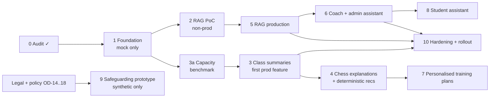

# AI implementation roadmap

Status: **Phase 1 approved 2026-10-19** (DECISIONS.md §4); every later phase is
still a proposal. Each phase starts only after the
owner approves it explicitly. OD-x refers to DECISIONS.md §3.

Every phase:

- ships behind flags that default to off
- uses only additive migrations
- rolls back by turning flags off and then restoring the `:last-good` image
- updates docs in the same change (CLAUDE.md rule 6/12)

**Why summaries come before RAG as the first production feature:**

- The evidence already exists [V].
- It needs no database extension.
- It needs no new content licensing.
- It has a built-in human gate (coach review).

RAG production waits for the PoC and the pgvector image decision.

| # | Objective | Deliverables | Depends on | Acceptance | Complexity / risk | Infra | Approval needed before starting |
|---|---|---|---|---|---|---|---|
| 0 | Audit and architecture | This doc set | — | Owner has reviewed it | — | — | — |
| 1 | Foundation | PHASE1_SPEC.md: one task (`diagnostic.echo.v1`), mock echo provider, Python runtime skeleton, contract v1.0 + drift check, service auth, opt-in `compose.ai.yml` overlay, tests, PR-only CI job | OD-1, OD-2, OD-20–OD-24 | PHASE1_SPEC.md §10 | M / low (no tables, flags off, production compose untouched) | None in prod; merging to `main` is an inert api + web rebuild (OD-22) | **Yes: OD-1, OD-2, OD-20–OD-24** |
| 2 | RAG proof of concept | RAG_POC.md: dataset manifest, eval set, report, go/no-go for pgvector | 1, OD-7 | RAG_POC.md §4 | M / low (off-box) | Dev machine or CI only | **Yes: OD-7 dataset licensing** |
| 3a | Inference capacity | Benchmark (INFRASTRUCTURE_DECISION.md §4); OCI limit inquiry | 1, OD-19 | Pass criteria in §4, or a documented no-go | S / medium (prod CPU during the off-hours run) | Temporary Ollama container, weights deleted afterwards | **Yes: OD-6, OD-19, a time window** |
| 3 | After-class summaries (first production AI) | `AiUsageEvent` + `ClassSummary` tables; evidence builder; worker (pauses while live); grounding validator; coach review and publish UI; student recap; privacy export and legal page update; golden set | 3a passed (or OD-3/OD-4 alternative), OD-5, OD-12, OD-11 | ≥ 95% of eligible classes READY within 2 h of the day's last live class; 0 grounding violations; `S#` leakage 0; coach "useful" ≥ 70% over 4 weeks; no measurable live-class impact | L / medium (privacy, model quality) | Ollama in the `ai` profile (`cpus 1.5`, `mem 5g`) | **Yes: OD-5, OD-6, OD-12, privacy text** |
| 4 | Chess explanations and deterministic recommendations | Weakness profile (SQL), explainable puzzle recommendations, LLM explanation of engine-supplied lines with SAN re-validation | 3 (generation path proven) | Offline: recommendations beat a random-in-band baseline on next-30-day solve rate; explanations 0 illegal moves | M / low-medium | As in 3 | Yes: scope sign-off |
| 5 | RAG production | Custom pgvector alpine image + CI image; knowledge tables; staff upload and approval UI; `PUBLIC_CHESS` + academy collection (coach audience); deletion and permission tests | 2 go, OD-6b, OD-7 | PoC metrics hold on the prod-like integration DB; permission and deletion suites green; DB swap rehearsed with a restore test | L / **medium-high (DB image change)** | DB image change, about 1–2 GB for vectors [A] | **Yes: OD-6b, maintenance window** |
| 6 | Coach and admin assistant | Assistant loop, tool registry (READ/DRAFT only), conversations with retention, throttles and budgets | 5 (search tool), 3a capacity for interactive use | 0 authorization bypasses in the tool-permission test matrix; scripted-dialogue success ≥ 80%; p95 answer latency defined by the capacity choice | L / medium | **Interactive capacity**: Option 2, 3 or 4 | **Yes: OD-10, capacity decision** |
| 7 | Personalised training plans | Coach-approved plan templates from the weakness profile; optional Python learned recommender evaluated offline | 4, enough data | Learned model beats the deterministic baseline offline before any exposure | M / medium | Runtime CPU (small) | Yes |
| 8 | Student assistant | Narrow-scope student profile, moderation, disclosure handling routed to policy, parent notice | 6, OD-9, safeguarding policy (not the classifier) | Red-team script passes (off-topic, injection, personal-data requests); notice published | M / **high (minors)** | As in 6 | **Yes: OD-9, legal/notice** |
| 9 | Safeguarding prototype | Detectors + review queue + access log on **synthetic data only**; no interception of real messages | OD-14 to OD-18 | Precision and recall per category reported; owner and legal sign-off **before any real-data flag** | M / **high** | Local only | **Yes: legal, policy, lead** |
| 10 | Hardening and rollout | Load and chaos tests (kill the runtime or Ollama mid-job), budget alerts, runbooks in TROUBLESHOOTING.md, a per-coach progressive enable | 3+ | Recovery without data loss; no live-class degradation under a synthetic load | M | — | Per rollout step |

## Cross-cutting prerequisites

| Item | Needed by |
|---|---|
| OD-19: recording cap fix and build-cache prune | Any model weights on the box (3a) |
| Privacy page (`features/legal/content.ts`) names the AI processing and retention | 3 |
| A staging decision (OD-11) | 3 rollout |
| `deploy-production.sh` learns the `ai-runtime` service (build, health gate, `:last-good`), the deploy/CI filters add `services/ai-runtime/**`, and the production `api` environment lists `AI_*` (PHASE1_SPEC.md §11) | 3 (first production use of the runtime) |
| Privacy export sections for `ClassSummary` and `AssistantConversation` | 3, 6 |
